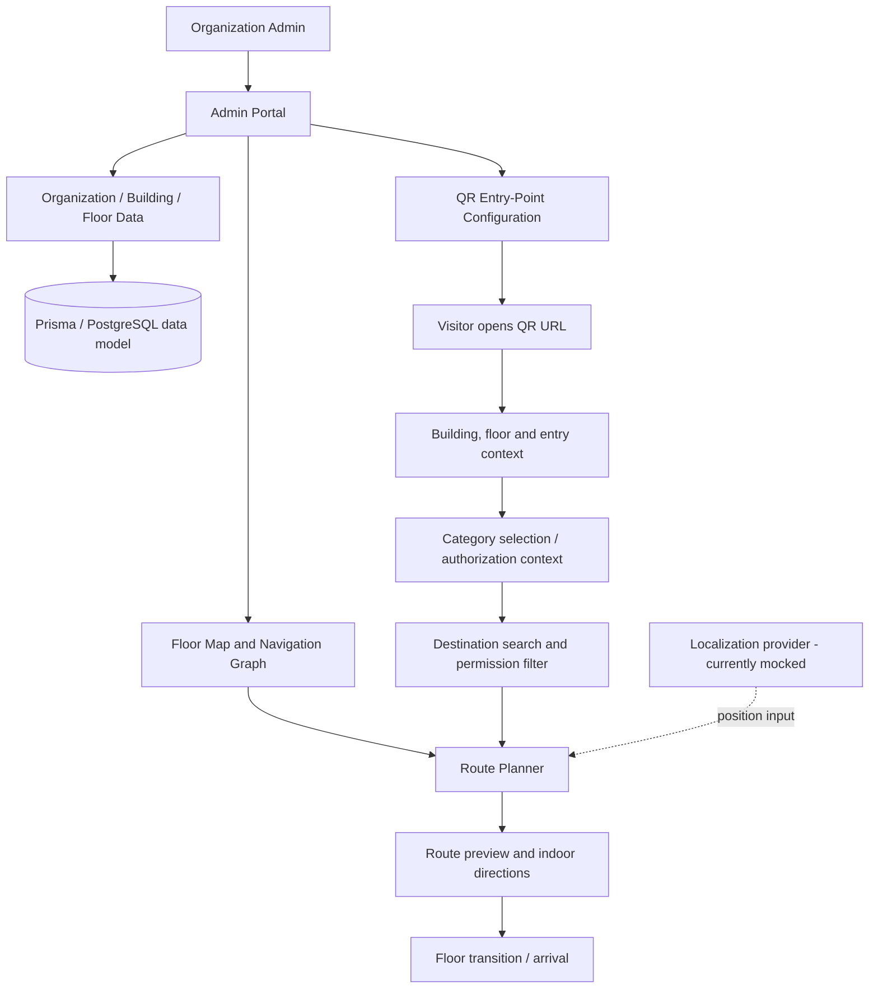

# NaviSense — QR-Enabled Indoor Navigation

NaviSense is a GPS-independent **indoor wayfinding platform prototype** for multi-floor buildings such as colleges, hospitals, offices, and public facilities. It combines an organization-managed indoor map and navigation graph with a mobile-first visitor experience launched from a QR code.

> **Project status:** research / demonstrator prototype. Some flows use mock data. Localization is simulated; the project does not currently provide continuous, sensor-validated positioning or production-grade physical access control. See [Current limitations](#current-status-and-limitations).

## Contents

- [Problem and goals](#problem-and-goals)
- [Key features](#key-features)
- [Role-aware destinations and restricted areas](#role-aware-destinations-and-restricted-areas--design-requirements)
- [System architecture](#system-architecture)
- [Navigation model](#navigation-model)
- [Technology stack](#technology-stack)
- [Repository layout](#repository-layout)
- [Getting started](#getting-started)
- [How a visitor uses NaviSense](#how-a-visitor-uses-navisense)
- [How an administrator uses NaviSense](#how-an-administrator-uses-navisense)
- [Research and evaluation plan](#research-and-evaluation-plan)
- [Security, privacy, and accessibility](#security-privacy-and-accessibility)
- [Current status and limitations](#current-status-and-limitations)
- [Roadmap](#roadmap)
- [References](#references)

## Problem and goals

Indoor visitors can struggle to find rooms, departments, services, and floor transitions in large or unfamiliar buildings. GPS is unreliable indoors, and static floor plans do not always provide step-by-step routes. NaviSense explores a QR-started, graph-based wayfinding workflow that does not require visitors to create an account.

Goals:

1. Give visitors a low-friction entry point by scanning a building-specific QR code.
2. Represent floor plans as a navigable graph of locations and walkable connections.
3. Search destinations and provide route previews, directions, distance estimates, and floor-transition guidance.
4. Let an organization configure buildings, floors, rooms, landmarks, QR entry points, and its navigation network.
5. Design for category-aware destination discovery and restricted-area-aware routing.
6. Provide a codebase that can be evaluated and extended for indoor navigation research.

## Key features

### Visitor experience

- QR-linked organization, building, floor, and entry-point context.
- Mobile-first visitor flow without mandatory visitor login.
- Destination search by room, room number, department, facility, service, or landmark.
- Search suggestions, categories, destination details, and empty/no-result states (as implemented in the UI).
- Route preview with source, destination, map route, estimated walking distance/time, and floor information.
- Indoor navigation screen with route line, next-step instructions, remaining-distance/progress UI, and floor selection.
- Floor-transition instructions for stairs/elevators.
- Arrival/destination-reached state.
- Localization abstraction that separates the UI from the positioning technology.

### Organization / administrator experience

- Admin authentication screens and organization-oriented setup flow.
- Organization → building → floor hierarchy.
- Building and floor management.
- Floor-map editor prototype with rooms, landmarks, navigation nodes, edges, and QR entry points.
- Room and landmark management.
- Navigation-network inspection and map-validation UI.
- QR-point management: building/floor/entry point, enable/disable and deployment-oriented states.
- Dashboard, setup progress, validation status, and organization settings.
- Mock data and client-side state for prototyping workflows.

### Platform and engineering

- React 19 + TypeScript component architecture.
- TanStack Router, Tailwind CSS, and reusable UI components.
- Indoor graph representation and route reconstruction.
- Per-floor route legs and turn/floor-transition instructions.
- Prisma data model for organizations, users, buildings, floors, rooms, landmarks, and QR codes.
- Express server endpoints for account registration/login and authenticated current-user lookup.
- Separation between navigation UI and localization provider, enabling future integration of QR re-localization, computer vision, BLE/Wi-Fi, IMU/PDR, or sensor fusion.

## Role-aware destinations and restricted areas — design requirements

NaviSense is intended for different building contexts. After a QR scan, a visitor should be able to select or confirm an appropriate category configured by the organization.

Example categories:

| Building type | Example categories | Example discoverable destinations |
|---|---|---|
| Hospital | Patient, visitor, doctor, nurse, staff | Reception, outpatient department, permitted wards, pharmacy |
| College | Student, professor, parent, visitor, staff | Classrooms, department offices, auditorium, reception |
| Office | Employee, contractor, visitor, facilities staff | Reception, meeting rooms, permitted departments |

The organization should configure category names and permissions rather than relying on a fixed global list.

### Access-aware route rules

- A destination can be visible/searchable only to authorized categories.
- A navigation node can be marked restricted.
- A graph edge/corridor can be marked unavailable to selected categories.
- Route search must exclude unauthorized nodes **and** unauthorized edges; hiding a destination in the interface alone is insufficient.
- If the destination is not permitted, explain that the location is unavailable for the selected category.
- If no authorized route exists, show “No permitted route is available” and offer an authorized alternative where possible.
- Permission checks should be enforced by trusted server-side logic when a backend route or destination API is introduced. Client-side filtering is only a user-experience layer.
- These rules guide navigation only. They do not physically lock doors or replace institutional safety/security procedures.

**Implementation status:** role-aware filtering and restricted-edge enforcement are research/product requirements to implement and test; do not interpret this section as proof that every current screen or API already enforces them.

## System architecture



The architecture separates three concerns:

1. **Map and graph:** locations, floor associations, walkable links, vertical transitions, and entry points.
2. **Route planning:** computes a connected path between a start node and destination node.
3. **Positioning and interaction:** obtains a starting context and presents instructions. The current localization layer is mocked rather than sensor-validated.

## Navigation model

The navigation network is modelled as a graph (G=(V,E)):

- (V): navigation nodes, such as corridors, intersections, rooms, entrances, stairs, elevators, landmarks, and QR entry points.
- (E): walkable or vertical connections between nodes.
- (c(u,v)): non-negative cost of traversing an edge.
- (s), (t): source and target nodes.

In the current route implementation, a horizontal edge uses Euclidean distance between floor-plan coordinates; a vertical edge uses a fixed search penalty. Displayed walking distance is calculated separately from horizontal segments. Consequently, **search cost and displayed metres are not the same unit/metric**, especially for multi-floor routes. This distinction must be documented in experiments and improved before making claims about physical shortest distance.

The evaluated prototype includes Dijkstra and A* routing implementations. Dijkstra remains the application default; the research benchmark compares both algorithms on identical graph/query inputs using the same binary min-heap and stale-entry policy. The results and limitations of that comparison are documented in the research evaluation section below.

For category-aware navigation, define a permitted graph for category (r):

`G_r=(V_r,E_r)`

where (V_r) contains the nodes accessible to category (r), and (E_r) contains only edges the category is allowed to traverse. Route search must run on (G_r), not on the unrestricted graph followed by UI filtering.

## Technology stack

| Layer | Technology / status |
|---|---|
| Frontend | React 19, TypeScript |
| Routing / build | TanStack Router, Vite |
| Styling | Tailwind CSS, reusable UI components |
| Visualization | SVG / React map UI and Recharts dependency |
| Server | Express |
| Persistence model | Prisma schema for PostgreSQL |
| Authentication | bcryptjs and JWT-based server flow; requires production hardening |
| Location | Mock localization abstraction in the current prototype |
| Route planning | Dijkstra default; A* available for the research comparison |
| Test / research | Add automated route, permissions, and benchmark tests before reporting measured findings |

## Repository layout

Selected paths (not an exhaustive tree):

- `src/lib/navisense/types.ts` — core organization, building, floor, room, landmark, node, edge, QR-point and navigation-data types.
- `src/lib/navisense/routing.ts` — graph search, path reconstruction, route legs, turn instructions, and distance/time estimates.
- `src/lib/navisense/localization.ts` — localization abstraction; currently mocked.
- `src/lib/navisense/mock-data.ts` — representative sample floor/building graph data.
- `src/` — React application and UI routes/components.
- `server/` — Express server endpoints.
- `prisma/schema.prisma` — relational data model.
- `package.json` — development, build, lint, and server scripts.

## Getting started

Prerequisites: Node.js compatible with the project dependencies and npm.

```bash
git clone https://github.com/Pranitee-Sonavane/NaviSense.git
cd NaviSense
npm install
npm run dev
```

Run the server separately if you are working on backend endpoints:

```bash
npm run dev:server
```

Useful scripts:

- `npm run dev` — start the Vite development server.
- `npm run build` — production frontend build.
- `npm run lint` — run ESLint.
- `npm run server` — start the Express server.
- `npm run dev:server` — run the server in watch mode.

Check the environment variables and Prisma configuration before enabling database-backed flows. Do not commit credentials, JWT secrets, database passwords, or production environment files.

## How a visitor uses NaviSense

1. Scan an active QR code at an entrance or known point.
2. Open the QR-linked building/floor context.
3. Select/confirm a category if the organization requires it.
4. Search for a destination.
5. See only destinations permitted for the selected category.
6. Select a destination and preview the route.
7. Follow floor-specific directions and use stairs/elevator instructions when needed.
8. Arrive at the destination or receive a clear no-route / not-authorized message.

The exact category and permission steps are a planned enhancement until they are implemented end-to-end.

## How an administrator uses NaviSense

1. Sign in to the admin portal.
2. Configure the organization and buildings.
3. Add floors and map/floor-plan metadata.
4. Configure rooms, landmarks, navigation nodes, and walkable connections.
5. Validate graph completeness and investigate disconnected locations.
6. Associate QR points with a building, floor, and entry node.
7. Review the deployment/publish state.
8. Configure categories, destination visibility, node restrictions, and corridor restrictions as the role-aware access feature is implemented.

## Research and evaluation plan

This section is the working research-paper draft. The measured results below are from the local evaluation report supplied for the 2026-10-18 evaluation. Before publication, commit the matching implementation, benchmark scripts, raw CSV files, and generated figures so the reported results can be reproduced from the repository.

### Research questions

- **RQ1:** Does A* preserve Dijkstra's route cost while changing search effort and runtime?
- **RQ2:** Does permission-aware graph filtering prevent route generation through restricted nodes and edges in the tested prototype fixtures?
- **RQ3:** How do route decisions, search effort, and runtime vary across graph sizes, graph shapes, route lengths, floor transitions, and unreachable queries?

### Experimental method

The benchmark compares Dijkstra and A* on identical graph arrays, endpoints, access contexts, and query inputs. Both algorithms use the same binary min-heap and stale-entry policy. Five warm-up runs alternate order; 30 measured paired trials alternate which algorithm runs first. Timings use \`performance.now()\` around the complete \`computeRoute()\` call, including per-call policy filtering, adjacency construction, and A* heuristic setup. Graph construction, independent path-cost validation, CSV writing, and logging are outside the timed region. No timing outliers were discarded.

Runtime and search counters are summarized as median [Q1, Q3]. Paired runtime change is the median [Q1, Q3] of per-trial \`100 × (A* runtime − Dijkstra runtime) / Dijkstra runtime\`; positive values mean A* was slower. Expanded nodes count valid, non-stale open-set removals, including the goal when reached. Examined edges count directed adjacency entries scanned while expanding those nodes.

**Environment:** Node v22.20.0; Windows 10 (x64; build 10.0.26300); AMD Ryzen 7 5825U; 16 logical CPUs; approximately 16.5 GB RAM. Evaluation metadata records 2026-10-18. Graphs are generated fixtures; the four-floor Engineering Block graph is mock data, not a surveyed building.

### Results and discussion

#### RQ1 — Route-cost agreement, runtime, and search effort

**Table 1. Runtime on generated three-floor grid graphs**

Use the median runtime and paired runtime change in the main paper. Keep the Q1–Q3 values from the full benchmark report in the table or appendix.

| Nodes | Query | Dijkstra runtime (ms), median [Q1, Q3] | A* runtime (ms), median [Q1, Q3] | Paired runtime change, median [Q1, Q3] |
|---:|---|---:|---:|---:|
| 300 | Same floor | 0.8807 [0.7517, 1.0945] | 0.9830 [0.9002, 1.2964] | +11.3% [+0.2%, +28.1%] |
| 300 | Cross floor | 1.0894 [1.0257, 1.3851] | 1.1673 [1.0437, 1.3799] | +3.4% [-6.4%, +12.1%] |
| 1,200 | Same floor | 1.4127 [1.3318, 1.6127] | 2.0846 [1.9288, 2.3910] | +42.5% [+23.8%, +61.0%] |
| 1,200 | Cross floor | 2.8198 [2.1476, 3.3207] | 3.2779 [2.6293, 3.9500] | +21.5% [-5.4%, +39.2%] |
| 2,700 | Same floor | 3.2775 [3.1735, 3.9057] | 4.4150 [4.2530, 4.6389] | +31.7% [+13.2%, +46.3%] |
| 2,700 | Cross floor | 5.4790 [4.9581, 6.2110] | 6.7552 [5.7309, 7.3924] | +20.6% [-0.4%, +43.0%] |

**[GENERATE FIGURE 1 HERE — Grid runtime comparison]**

- **Chart type:** line chart with markers and Q1–Q3 error bars.
- **Data:** \`routing-benchmarks.csv\`.
- **X-axis:** graph nodes (300, 1,200, 2,700).
- **Y-axis:** median runtime in milliseconds.
- **Series:** Dijkstra and A*.
- **Layout:** separate panels for same-floor and cross-floor queries.
- **Caption:** “Median routing runtime by grid size and query type; error bars show the interquartile range across 30 trials.”

**Table 2. Search effort and path-cost agreement on grid graphs**

| Nodes | Query | Dijkstra expanded nodes | A* expanded nodes | Cost agreement |
|---:|---|---:|---:|---:|
| 300 | Same floor | 100 [100, 100] | 83 [83, 83] | 30/30 |
| 300 | Cross floor | 295 [295, 295] | 208 [208, 208] | 30/30 |
| 1,200 | Same floor | 400 [400, 400] | 363 [363, 363] | 30/30 |
| 1,200 | Cross floor | 1,195 [1,195, 1,195] | 885 [885, 885] | 30/30 |
| 2,700 | Same floor | 985 [985, 985] | 843 [843, 843] | 30/30 |
| 2,700 | Cross floor | 2,695 [2,695, 2,695] | 1,921 [1,921, 1,921] | 30/30 |

**[GENERATE FIGURE 2 HERE — Expanded nodes by grid size]**

- **Chart type:** line chart with markers.
- **Data:** \`routing-benchmarks.csv\`.
- **X-axis:** graph nodes.
- **Y-axis:** median expanded nodes.
- **Series:** Dijkstra and A*, with separate panels for same-floor and cross-floor queries.
- **Caption:** “Expanded nodes by grid size and query type. A* expands fewer nodes in all six grid groups.”

**Text for the paper:** Across the six grid benchmark groups, A* matched Dijkstra's independently recomputed path cost in all 180 paired trials. A* expanded fewer nodes in every group. However, A* had a higher median paired runtime change in every group, ranging from +3.4% to +42.5%. For the 2,700-node same-floor query, A* expanded 843 nodes compared with 985 for Dijkstra, but its median runtime was 4.4150 ms compared with 3.2775 ms. The reduction in search effort therefore did not translate into lower total execution time under these tested conditions. The results apply to these generated grids and do not establish that A* is generally slower for indoor navigation.

#### RQ2 — Permission-aware route behavior

**Table 3. Deterministic permission-fixture outcomes**

| Scenario | Staff expected / observed | Visitor expected / observed | Outcome |
|---|---|---|---|
| Authorized alternative | Route / found | Route / found | Both algorithms passed |
| Missing floor transition | No route / none | No route / none | Both algorithms passed |
| No permitted route | Route / found | No route / none | Both algorithms passed |
| Restricted destination | Route / found | No route / none; destination hidden in filtered results | Both algorithms passed |
| Restricted floor transition | Route / found | No route / none | Both algorithms passed |
| Restricted node | Route / found | No route / none | Both algorithms passed |

Reported permission-fixture summary: zero unauthorized routes among 12 generated routes; 12/12 expected no-route decisions passed; 12/12 authorized-route checks passed; restricted destination visibility was 0/2 algorithm-cases in the visitor-filtered result set; zero forbidden-edge traversals were recorded.

**Before final submission:** document exactly what the denominator “12 generated routes” counts. Distinguish scenario-level cases from individual algorithm evaluations because the six scenarios, two principal types, and two algorithms can yield more than 12 individual evaluations. Do not describe these deterministic fixtures as a security audit or as evidence of backend authorization.

**[GENERATE FIGURE 3 HERE — Permission-filtering example]**

- **Chart type:** explanatory node-and-edge diagram, not a statistical chart.
- Draw a start node, destination, one restricted path, and an allowed alternative path. Use a clear legend for permitted and restricted nodes/edges.
- Add a second small panel showing “No permitted route” when all possible paths include a restricted element.
- **Caption:** “Illustration of route filtering using the supplied permission context. This is a schematic example, not a surveyed building map.”

**Text for the paper:** The deterministic permission fixtures showed that the tested route-search function applied the supplied access context consistently for the evaluated restricted destinations, nodes, and edges. All reported expected no-route decisions passed, and no forbidden-edge traversals or unauthorized routes were recorded in the generated cases. These results demonstrate application-level filtering in the prototype only. They do not establish backend authorization or confidentiality because mock data remains inspectable in the browser bundle and the repository does not currently provide a trusted route-planning API that enforces these restrictions.

#### RQ3 — Graph shape, route length, floors, and unreachable queries

The graph-shape evaluation contains 390 paired trials across corridor-tree, irregular-floor-plan, obstacle-heavy, sparse-disconnected, and generated Engineering Block mock graphs. Both algorithms matched expected route availability in 390/390 trials; all 330 successful paired routes had matching path costs.

**Table 4. Runtime across graph shapes and query types**

| Graph / query | Nodes | Dijkstra runtime (ms) | A* runtime (ms) | Paired runtime change | Cost agreement |
|---|---:|---:|---:|---:|---:|
| Corridor tree — long | 160 | 0.7567 | 0.8649 | +14.3% | 30/30 |
| Corridor tree — short | 160 | 0.2812 | 0.3527 | +39.2% | 30/30 |
| Irregular floor plan — long | 120 | 0.5554 | 0.6253 | +12.1% | 30/30 |
| Irregular floor plan — short | 120 | 0.3304 | 0.4079 | +26.3% | 30/30 |
| Engineering Block mock — cross-floor | 61 | 0.2437 | 0.2994 | +11.1% | 30/30 |
| Engineering Block mock — long | 61 | 0.1436 | 0.1668 | +17.0% | 30/30 |
| Engineering Block mock — short | 61 | 0.1690 | 0.1902 | +18.0% | 30/30 |
| Engineering Block mock — unreachable | 61 | 0.0168 | 0.0169 | +1.8% | N/A |
| Obstacle-heavy — long | 324 | 1.3274 | 1.5212 | +17.2% | 30/30 |
| Obstacle-heavy — short | 324 | 0.6311 | 0.7611 | +20.4% | 30/30 |
| Sparse graph — long | 60 | 0.0492 | 0.0654 | +31.1% | 30/30 |
| Sparse graph — short | 60 | 0.0317 | 0.0482 | +43.3% | 30/30 |
| Sparse graph — unreachable | 60 | 0.1155 | 0.1315 | +14.7% | N/A |

*Note:* The table displays medians for readability. The complete report should preserve Q1–Q3 for runtime, paired runtime change, expanded nodes, and examined edges. Unreachable queries have no route cost to compare.

**[GENERATE FIGURE 4 HERE — Paired runtime change by graph/query type]**

- **Chart type:** horizontal dot plot with horizontal Q1–Q3 error bars.
- **Data:** \`graph-shape-benchmarks.csv\`.
- **Y-axis:** the 13 graph/query groups from Table 4.
- **X-axis:** median paired runtime change (%).
- Add a vertical reference line at 0%; values to the right indicate A* was slower.
- **Caption:** “Median paired runtime change across graph-shape queries; error bars show the interquartile range of paired per-trial percentage changes.”

**Text for the paper:** Across the 390 graph-shape paired trials, Dijkstra and A* matched the expected reachable or unreachable status in every trial. All 330 successful paired routes had matching path costs. A* expanded fewer nodes in most reachable query groups, although the amount of reduction varied with graph structure and route length. A* had a higher median paired runtime change in all 13 reported groups. This finding is specific to the tested fixtures and runtime environment. The Engineering Block graph is generated mock data, not a surveyed building.

### Discussion

The experiments show a distinction between search effort and end-to-end runtime. A* often expanded fewer nodes than Dijkstra, but the timed function also includes policy filtering, adjacency construction, and heuristic setup/evaluation. That additional work may outweigh the reduction in expansions for these fixtures. The present measurements do not isolate the cost of each component, so this explanation should be treated as a plausible interpretation rather than a proven causal result. The paired runtime IQR crosses zero in several groups; avoid claiming a statistically significant runtime difference without an appropriate paired statistical analysis.

The route optimizer minimizes **generalized routing cost**, not physical walking distance. Walk edges use Euclidean floor-plan units, while vertical edges receive a fixed cost of 220. The displayed \`NaviRoute.distance\` sums horizontal walk segments only, divides by 11 units per metre, and rounds; it excludes vertical penalty and physical vertical travel length. Keep routing-cost optimality and displayed distance as separate metrics in the paper.

### Limitations and threats to validity

- The grids and graph-shape fixtures are generated; the Engineering Block graph is illustrative mock data, not a surveyed building.
- Runtime measurements come from one Windows/Node environment and are sensitive to JIT, system load, and millisecond-scale timing noise.
- Localization is mocked; no positioning-accuracy or real-world wayfinding study was performed.
- Permission tests are deterministic prototype fixtures, not a security audit. Restricted mock data remains available in the browser bundle; filtering is not a security boundary.
- The route cost mixes horizontal geometric units and a fixed vertical penalty. It is not a validated physical-distance objective.
- The evaluation establishes results for the tested graph/query fixtures only; it does not establish that A* is generally slower or faster for indoor navigation.

### Reproducibility commands

Run these commands from the project root after the benchmark scripts and report generators are present:

\`\`\`powershell
npm.cmd test
npx.cmd tsc --noEmit
npm.cmd run build
npm.cmd run benchmark:routing
npm.cmd run benchmark:routing:shapes
npm.cmd run benchmark:routing:permissions
python research/summarize-routing-benchmarks.py
python research/summarize-research-evaluation.py
python research/plot-routing-benchmarks.py
\`\`\`

Raw files reported by the local evaluation: \`routing-benchmarks.csv\`, \`graph-shape-benchmarks.csv\`, and \`permission-benchmarks.csv\`. Ensure these files and the scripts are included in the version used for final submission.

### Final figure-placement checklist

1. **System architecture:** place in “System architecture” / proposed system, before the evaluation section.
2. **Figure 1 — Grid runtime:** immediately after Table 1 in RQ1.
3. **Figure 2 — Expanded nodes:** immediately after Table 2 in RQ1.
4. **Figure 3 — Permission-filtering schematic:** immediately after Table 3 in RQ2.
5. **Figure 4 — Runtime change by graph shape:** immediately after Table 4 in RQ3.

The bracketed figure markers above are instructions for the author. Replace each marker with the generated figure and its caption in the final paper; do not leave the markers in the submitted PDF.

## Security, privacy, and accessibility

- Visitors should not need accounts unless a deployment explicitly requires them.
- Do not treat a QR code as proof of identity or authorization; it provides location/context, not secure authentication.
- Category-based navigation permissions must be enforced on trusted APIs as well as in the UI.
- Avoid exposing sensitive destinations in public search responses.
- Use secure password hashing, strong environment-provided JWT secrets, token expiry/rotation policies, input validation, rate limiting, and HTTPS before deployment.
- A navigation restriction is not a physical access-control mechanism.
- Design for keyboard use, visible focus, readable contrast, descriptive labels, touch targets, and non-color-only status cues.
- Do not claim accessibility or safety certification without formal testing.

## Current status and limitations

The repository is a prototype and should be described honestly in project reviews and research writing.

- Dijkstra remains the application default; A* is included for research comparison.
- The benchmarked Dijkstra and A* implementations share a binary min-heap and stale-entry policy.
- The graph and floor-plan examples include mock/sample data.
- Localization is simulated; confidence values are not measured positioning accuracy.
- QR links provide an entry context, not continuous tracking.
- Some administrative data flows use client/mock state; the database schema and server are not proof that every UI action persists to PostgreSQL.
- Authentication code requires security review and production configuration; development fallbacks must not be used in production.
- Permission-aware filtering for restricted nodes/edges is evaluated in deterministic prototype fixtures; trusted server-side enforcement remains unimplemented and must be added before claiming production access control.
- No real-world user study, navigation accuracy study, or algorithm benchmark should be claimed until it has been run and documented.

## Roadmap

- [ ] Define organization-configurable user categories and permissions.
- [ ] Add destination visibility rules by category.
- [ ] Add node and edge access metadata and build the authorized graph per category.
- [ ] Enforce permission checks on backend destination and route endpoints.
- [x] Implement A* alongside Dijkstra and compare path cost, expanded nodes, and runtime in generated fixtures.
- [x] Add automated route-optimality, disconnected-graph, vertical-transition, and permission-fixture tests.
- [x] Build a repeatable benchmark harness and generate raw CSV results for the local evaluation; commit these artifacts before publication.
- [ ] Fix the distinction between search cost and displayed physical distance; define explicit edge weights/units.
- [ ] Add persistent admin editing and integration tests.
- [ ] Replace mocked localization only after selecting and validating a real positioning approach.
- [ ] Conduct usability, accessibility, and real-building validation before deployment.

## References

1. J. Kunhoth, A. Karkar, S. Al-Maadeed, and A. Al-Ali, “Indoor positioning and wayfinding systems: a survey,” *Human-centric Computing and Information Sciences*, vol. 10, art. 18, 2020. [https://doi.org/10.1186/s13673-020-00222-0](https://doi.org/10.1186/s13673-020-00222-0)
2. S. J. Jamshidi, M. Ensafi, and D. Pati, “Wayfinding in Interior Environments: An Integrative Review,” *Frontiers in Psychology*, vol. 11, 2020. [https://doi.org/10.3389/fpsyg.2020.549628](https://doi.org/10.3389/fpsyg.2020.549628)
3. E. W. Dijkstra, “A note on two problems in connexion with graphs,” *Numerische Mathematik*, vol. 1, pp. 269–271, 1959. [https://doi.org/10.1007/BF01386390](https://doi.org/10.1007/BF01386390)
4. P. E. Hart, N. J. Nilsson, and B. Raphael, “A formal basis for the heuristic determination of minimum cost paths,” *IEEE Transactions on Systems Science and Cybernetics*, vol. 4, no. 2, pp. 100–107, 1968. [https://doi.org/10.1109/TSSC.1968.3001364](https://doi.org/10.1109/TSSC.1968.3001364)
5. S. J. Park et al., “A comparison of network model creation algorithms based on the quality of wayfinding results,” *Transactions in GIS*, 2020. [https://doi.org/10.1111/tgis.12632](https://doi.org/10.1111/tgis.12632)
