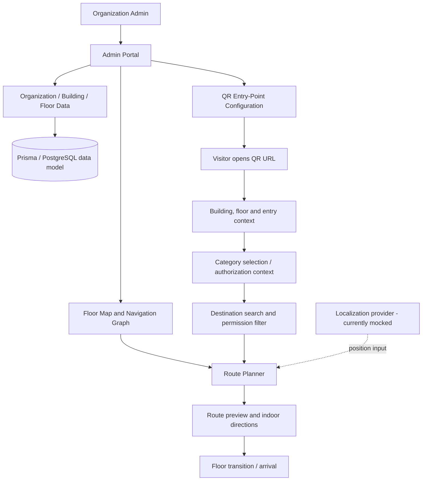

# NaviSense — QR-Enabled Indoor Navigation

NaviSense is a GPS-independent **indoor wayfinding platform prototype** for multi-floor buildings such as colleges, hospitals, offices, and public facilities. It combines an organization-managed indoor map and navigation graph with a mobile-first visitor experience launched from a QR code.

> **Project status:** research / demonstrator prototype. Some flows use mock data. Localization is simulated; the project does not currently provide continuous, sensor-validated positioning or production-grade physical access control. See [Current limitations](#current-status-and-limitations).

## Contents

- [Problem and goals](#problem-and-goals)
- [Key features](#key-features)
- [Role-aware destinations and restricted areas](#role-aware-destinations-and-restricted-areas--design-requirements)
- [System architecture](#system-architecture)
- [Navigation model](#navigation-model)
- [Technology stack](#technology-stack)
- [Repository layout](#repository-layout)
- [Getting started](#getting-started)
- [How a visitor uses NaviSense](#how-a-visitor-uses-navisense)
- [How an administrator uses NaviSense](#how-an-administrator-uses-navisense)
- [Research and evaluation plan](#research-and-evaluation-plan)
- [Security, privacy, and accessibility](#security-privacy-and-accessibility)
- [Current status and limitations](#current-status-and-limitations)
- [Roadmap](#roadmap)
- [References](#references)

## Problem and goals

Indoor visitors can struggle to find rooms, departments, services, and floor transitions in large or unfamiliar buildings. GPS is unreliable indoors, and static floor plans do not always provide step-by-step routes. NaviSense explores a QR-started, graph-based wayfinding workflow that does not require visitors to create an account.

Goals:

1. Give visitors a low-friction entry point by scanning a building-specific QR code.
2. Represent floor plans as a navigable graph of locations and walkable connections.
3. Search destinations and provide route previews, directions, distance estimates, and floor-transition guidance.
4. Let an organization configure buildings, floors, rooms, landmarks, QR entry points, and its navigation network.
5. Design for category-aware destination discovery and restricted-area-aware routing.
6. Provide a codebase that can be evaluated and extended for indoor navigation research.

## Key features

### Visitor experience

- QR-linked organization, building, floor, and entry-point context.
- Mobile-first visitor flow without mandatory visitor login.
- Destination search by room, room number, department, facility, service, or landmark.
- Search suggestions, categories, destination details, and empty/no-result states (as implemented in the UI).
- Route preview with source, destination, map route, estimated walking distance/time, and floor information.
- Indoor navigation screen with route line, next-step instructions, remaining-distance/progress UI, and floor selection.
- Floor-transition instructions for stairs/elevators.
- Arrival/destination-reached state.
- Localization abstraction that separates the UI from the positioning technology.

### Organization / administrator experience

- Admin authentication screens and organization-oriented setup flow.
- Organization → building → floor hierarchy.
- Building and floor management.
- Floor-map editor prototype with rooms, landmarks, navigation nodes, edges, and QR entry points.
- Room and landmark management.
- Navigation-network inspection and map-validation UI.
- QR-point management: building/floor/entry point, enable/disable and deployment-oriented states.
- Dashboard, setup progress, validation status, and organization settings.
- Mock data and client-side state for prototyping workflows.

### Platform and engineering

- React 19 + TypeScript component architecture.
- TanStack Router, Tailwind CSS, and reusable UI components.
- Indoor graph representation and route reconstruction.
- Per-floor route legs and turn/floor-transition instructions.
- Prisma data model for organizations, users, buildings, floors, rooms, landmarks, and QR codes.
- Express server endpoints for account registration/login and authenticated current-user lookup.
- Separation between navigation UI and localization provider, enabling future integration of QR re-localization, computer vision, BLE/Wi-Fi, IMU/PDR, or sensor fusion.

## Role-aware destinations and restricted areas — design requirements

NaviSense is intended for different building contexts. After a QR scan, a visitor should be able to select or confirm an appropriate category configured by the organization.

Example categories:

| Building type | Example categories | Example discoverable destinations |
|---|---|---|
| Hospital | Patient, visitor, doctor, nurse, staff | Reception, outpatient department, permitted wards, pharmacy |
| College | Student, professor, parent, visitor, staff | Classrooms, department offices, auditorium, reception |
| Office | Employee, contractor, visitor, facilities staff | Reception, meeting rooms, permitted departments |

The organization should configure category names and permissions rather than relying on a fixed global list.

### Access-aware route rules

- A destination can be visible/searchable only to authorized categories.
- A navigation node can be marked restricted.
- A graph edge/corridor can be marked unavailable to selected categories.
- Route search must exclude unauthorized nodes **and** unauthorized edges; hiding a destination in the interface alone is insufficient.
- If the destination is not permitted, explain that the location is unavailable for the selected category.
- If no authorized route exists, show “No permitted route is available” and offer an authorized alternative where possible.
- Permission checks should be enforced by trusted server-side logic when a backend route or destination API is introduced. Client-side filtering is only a user-experience layer.
- These rules guide navigation only. They do not physically lock doors or replace institutional safety/security procedures.

**Implementation status:** role-aware filtering and restricted-edge enforcement are research/product requirements to implement and test; do not interpret this section as proof that every current screen or API already enforces them.

## System architecture



The architecture separates three concerns:

1. **Map and graph:** locations, floor associations, walkable links, vertical transitions, and entry points.
2. **Route planning:** computes a connected path between a start node and destination node.
3. **Positioning and interaction:** obtains a starting context and presents instructions. The current localization layer is mocked rather than sensor-validated.

## Navigation model

The navigation network is modelled as a graph (G=(V,E)):

- (V): navigation nodes, such as corridors, intersections, rooms, entrances, stairs, elevators, landmarks, and QR entry points.
- (E): walkable or vertical connections between nodes.
- (c(u,v)): non-negative cost of traversing an edge.
- (s), (t): source and target nodes.

In the current route implementation, a horizontal edge uses Euclidean distance between floor-plan coordinates; a vertical edge uses a fixed search penalty. Displayed walking distance is calculated separately from horizontal segments. Consequently, **search cost and displayed metres are not the same unit/metric**, especially for multi-floor routes. This distinction must be documented in experiments and improved before making claims about physical shortest distance.

The current implementation in `src/lib/navisense/routing.ts` uses Dijkstra-style graph search. It repeatedly sorts a queue by accumulated path cost and reconstructs the path, floor-specific route legs, and instructions. It does **not** currently implement A* in that file. A* comparison should only be reported after a separate implementation is added and tested.

For category-aware navigation, define a permitted graph for category (r):

`G_r=(V_r,E_r)`

where (V_r) contains the nodes accessible to category (r), and (E_r) contains only edges the category is allowed to traverse. Route search must run on (G_r), not on the unrestricted graph followed by UI filtering.

## Technology stack

| Layer | Technology / status |
|---|---|
| Frontend | React 19, TypeScript |
| Routing / build | TanStack Router, Vite |
| Styling | Tailwind CSS, reusable UI components |
| Visualization | SVG / React map UI and Recharts dependency |
| Server | Express |
| Persistence model | Prisma schema for PostgreSQL |
| Authentication | bcryptjs and JWT-based server flow; requires production hardening |
| Location | Mock localization abstraction in the current prototype |
| Route planning | Dijkstra-style search in `src/lib/navisense/routing.ts` |
| Test / research | Add automated route, permissions, and benchmark tests before reporting measured findings |

## Repository layout

Selected paths (not an exhaustive tree):

- `src/lib/navisense/types.ts` — core organization, building, floor, room, landmark, node, edge, QR-point and navigation-data types.
- `src/lib/navisense/routing.ts` — graph search, path reconstruction, route legs, turn instructions, and distance/time estimates.
- `src/lib/navisense/localization.ts` — localization abstraction; currently mocked.
- `src/lib/navisense/mock-data.ts` — representative sample floor/building graph data.
- `src/` — React application and UI routes/components.
- `server/` — Express server endpoints.
- `prisma/schema.prisma` — relational data model.
- `package.json` — development, build, lint, and server scripts.

## Getting started

Prerequisites: Node.js compatible with the project dependencies and npm.

```bash
git clone https://github.com/Pranitee-Sonavane/NaviSense.git
cd NaviSense
npm install
npm run dev
```

Run the server separately if you are working on backend endpoints:

```bash
npm run dev:server
```

Useful scripts:

- `npm run dev` — start the Vite development server.
- `npm run build` — production frontend build.
- `npm run lint` — run ESLint.
- `npm run server` — start the Express server.
- `npm run dev:server` — run the server in watch mode.

Check the environment variables and Prisma configuration before enabling database-backed flows. Do not commit credentials, JWT secrets, database passwords, or production environment files.

## How a visitor uses NaviSense

1. Scan an active QR code at an entrance or known point.
2. Open the QR-linked building/floor context.
3. Select/confirm a category if the organization requires it.
4. Search for a destination.
5. See only destinations permitted for the selected category.
6. Select a destination and preview the route.
7. Follow floor-specific directions and use stairs/elevator instructions when needed.
8. Arrive at the destination or receive a clear no-route / not-authorized message.

The exact category and permission steps are a planned enhancement until they are implemented end-to-end.

## How an administrator uses NaviSense

1. Sign in to the admin portal.
2. Configure the organization and buildings.
3. Add floors and map/floor-plan metadata.
4. Configure rooms, landmarks, navigation nodes, and walkable connections.
5. Validate graph completeness and investigate disconnected locations.
6. Associate QR points with a building, floor, and entry node.
7. Review the deployment/publish state.
8. Configure categories, destination visibility, node restrictions, and corridor restrictions as the role-aware access feature is implemented.

## Research and evaluation plan

The proposed study evaluates NaviSense as an indoor wayfinding prototype and investigates graph-search behavior under category-specific access constraints.

### Research questions

- **RQ1:** Can A* reduce route-planning computation relative to Dijkstra while returning the same optimal cost under a valid admissible heuristic?
- **RQ2:** Can role-aware graph filtering prevent route generation through restricted nodes and corridors?
- **RQ3:** How do route success, route cost, explored nodes, and runtime vary with graph size, floor transitions, and permission constraints?

### Metrics

- Route success rate and path validity.
- Search cost and displayed walking distance, reported separately.
- Expanded/visited node count.
- Algorithm runtime, using repeated trials and reporting median and spread.
- Optimal-cost agreement between Dijkstra and A*.
- Unauthorized destination exposure count.
- Forbidden-edge traversals in generated routes.
- Correct handling of unreachable or unauthorized destinations.

### Required experimental discipline

Do not insert guessed benchmark numbers or create graphs that look like measured results. Use a repeatable benchmark script, fixed test graphs and seeds, warm-up trials, multiple repetitions, and a recorded software/hardware environment. Label synthetic graph experiments as synthetic. Record whether each test uses mock data, generated data, or a real mapped building.

## Security, privacy, and accessibility

- Visitors should not need accounts unless a deployment explicitly requires them.
- Do not treat a QR code as proof of identity or authorization; it provides location/context, not secure authentication.
- Category-based navigation permissions must be enforced on trusted APIs as well as in the UI.
- Avoid exposing sensitive destinations in public search responses.
- Use secure password hashing, strong environment-provided JWT secrets, token expiry/rotation policies, input validation, rate limiting, and HTTPS before deployment.
- A navigation restriction is not a physical access-control mechanism.
- Design for keyboard use, visible focus, readable contrast, descriptive labels, touch targets, and non-color-only status cues.
- Do not claim accessibility or safety certification without formal testing.

## Current status and limitations

The repository is a prototype and should be described honestly in project reviews and research writing.

- The current routing function implements Dijkstra-style search, not A*.
- The route queue uses repeated sorting rather than a priority heap.
- The graph and floor-plan examples include mock/sample data.
- Localization is simulated; confidence values are not measured positioning accuracy.
- QR links provide an entry context, not continuous tracking.
- Some administrative data flows use client/mock state; the database schema and server are not proof that every UI action persists to PostgreSQL.
- Authentication code requires security review and production configuration; development fallbacks must not be used in production.
- Category-aware filtering, restricted nodes/edges, and server-side permission enforcement must be implemented and tested before claiming restricted-area prevention as a working feature.
- No real-world user study, navigation accuracy study, or algorithm benchmark should be claimed until it has been run and documented.

## Roadmap

- [ ] Define organization-configurable user categories and permissions.
- [ ] Add destination visibility rules by category.
- [ ] Add node and edge access metadata and build the authorized graph per category.
- [ ] Enforce permission checks on backend destination and route endpoints.
- [ ] Implement A* alongside Dijkstra and compare path cost, expanded nodes, and runtime.
- [ ] Add automated tests for route optimality, disconnected graphs, vertical transitions, restricted corridors, and unauthorized destinations.
- [ ] Build a repeatable benchmark harness and save raw CSV results.
- [ ] Fix the distinction between search cost and displayed physical distance; define explicit edge weights/units.
- [ ] Add persistent admin editing and integration tests.
- [ ] Replace mocked localization only after selecting and validating a real positioning approach.
- [ ] Conduct usability, accessibility, and real-building validation before deployment.

## References

1. J. Kunhoth, A. Karkar, S. Al-Maadeed, and A. Al-Ali, “Indoor positioning and wayfinding systems: a survey,” *Human-centric Computing and Information Sciences*, vol. 10, art. 18, 2020. [https://doi.org/10.1186/s13673-020-00222-0](https://doi.org/10.1186/s13673-020-00222-0)
2. S. J. Jamshidi, M. Ensafi, and D. Pati, “Wayfinding in Interior Environments: An Integrative Review,” *Frontiers in Psychology*, vol. 11, 2020. [https://doi.org/10.3389/fpsyg.2020.549628](https://doi.org/10.3389/fpsyg.2020.549628)
3. E. W. Dijkstra, “A note on two problems in connexion with graphs,” *Numerische Mathematik*, vol. 1, pp. 269–271, 1959. [https://doi.org/10.1007/BF01386390](https://doi.org/10.1007/BF01386390)
4. P. E. Hart, N. J. Nilsson, and B. Raphael, “A formal basis for the heuristic determination of minimum cost paths,” *IEEE Transactions on Systems Science and Cybernetics*, vol. 4, no. 2, pp. 100–107, 1968. [https://doi.org/10.1109/TSSC.1968.3001364](https://doi.org/10.1109/TSSC.1968.3001364)
5. S. J. Park et al., “A comparison of network model creation algorithms based on the quality of wayfinding results,” *Transactions in GIS*, 2020. [https://doi.org/10.1111/tgis.12632](https://doi.org/10.1111/tgis.12632)
