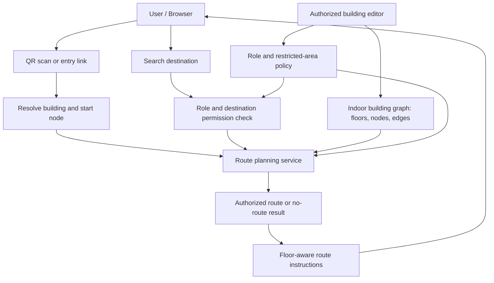
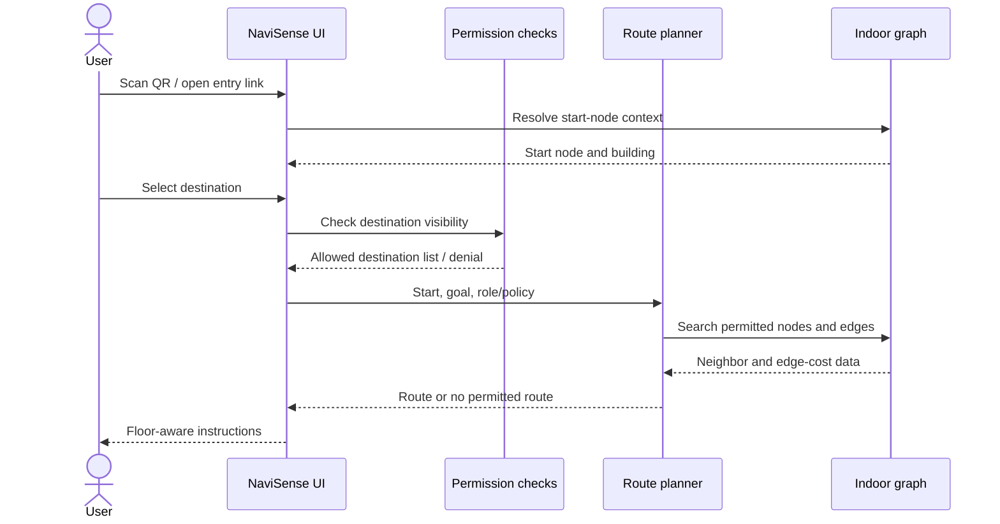
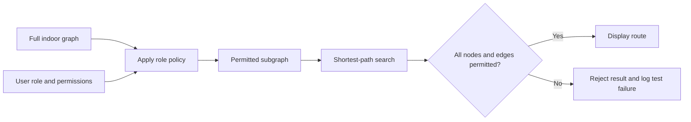

# NaviSense: QR-Enabled, Role-Aware Indoor Wayfinding with Graph-Based Route Planning

**Manuscript type:** System design and experimental evaluation paper  
**Draft status:** Results section populated from the supplied local benchmark reports; raw CSV/script verification and figure insertion remain before submission.  
**Author(s):** [Author name(s)]  
**Affiliation:** [Department, institution, city, country]  
**Corresponding author:** [Email]  
**Target template:** [Insert required IEEE / conference template and paper ID, if applicable]

> **Important before submission.** The results section has been populated from the supplied local benchmark reports. Verify every value against the raw CSVs and benchmarked commit, generate and insert only figures supported by those files, and clarify the permission-test counting unit. Localization remains mocked and some administrative state is client/mock state; do not imply continuous positioning or production-grade authorization. Replace every remaining bracketed field before submission.

## Abstract

Indoor wayfinding is challenging in multi-floor buildings because satellite-based positioning is often unreliable indoors and static maps do not provide route-specific guidance. This paper presents NaviSense, a QR-started indoor wayfinding prototype that models indoor circulation as a graph and investigates graph-search performance and role-aware route constraints. A controlled benchmark compared Dijkstra and A* over generated grid and graph-shape fixtures using 30 paired trials per query group. Route availability agreed in all 570 paired trials, and independently recomputed path costs matched in all 510 successful pairs. A* expanded fewer nodes in the six grid groups, but had higher median paired runtime in all reported grid and graph-shape groups. Deterministic permission fixtures reported no forbidden-edge traversals, although the tests do not establish production security because authorization remains prototype-level and client-side data may be exposed. Localization remains simulated, and the Engineering Block graph is mock data rather than a surveyed building. These results characterize the tested implementation and fixtures only; they do not establish real-world positioning accuracy, usability, or general algorithm superiority.

**Keywords—** indoor navigation, indoor wayfinding, QR code, graph algorithms, Dijkstra's algorithm, A* search, role-based access control, route planning, web application.

---

## I. Introduction

Indoor wayfinding helps people move through buildings whose corridors, rooms, stairs, lifts, entrances, and access restrictions may be unfamiliar. Examples include university campuses, hospitals, office complexes, museums, and public-service buildings. Finding a room in such environments is not simply a matter of displaying a floor plan: a useful system must identify a starting context, locate the intended destination in the building model, compute a traversable route, communicate floor transitions, and avoid areas the current user is not permitted to enter.

Satellite navigation is generally unsuitable for precise indoor positioning because signals may be attenuated, reflected, or blocked by building materials. Indoor positioning and navigation research consequently spans infrastructure-based methods, radio-frequency techniques, inertial approaches, visual methods, map-based approaches, and hybrid systems [1]–[4], [6], [13]. These approaches differ in infrastructure cost, accuracy, maintenance burden, privacy implications, and device requirements. For a prototype intended to be usable through a browser, a QR code can provide an explicit starting context without requiring continuous positioning hardware. However, a QR code by itself does not continuously track a moving person: it identifies a scan point or entry context, and the application must avoid implying otherwise.

A second challenge is that the shortest geometric route is not always a valid route. A corridor may be staff-only, a laboratory may be restricted, or a room may be visible only to a specific role. Role-based access control (RBAC) offers a conceptual basis for associating permissions with roles rather than individual users [12]. In an indoor navigation system, these permissions must affect both destination discovery and graph traversability. Hiding a restricted room from search while leaving a route through a restricted corridor available would be an incomplete enforcement strategy.

NaviSense is a web-based indoor wayfinding prototype that models indoor spaces as floors, rooms, landmarks, nodes, edges, and QR entry points. Its current routing implementation uses a Dijkstra-style graph search. This paper documents the system and proposes a controlled comparison with A*, alongside tests of role-aware destination filtering and restricted-edge avoidance. The objective is not to claim that QR navigation, graph search, or RBAC is individually new; instead, the study investigates their combined behavior in the context of a practical web application and defines a repeatable evaluation method.

### A. Research questions

This study is organized around the following research questions:

- **RQ1:** How do Dijkstra's algorithm and A* compare in route cost, execution time, and number of expanded nodes on the same indoor navigation graphs?
- **RQ2:** Does role-aware destination filtering prevent users from discovering destinations for which they lack permission?
- **RQ3:** Does restricting unauthorized nodes and edges during graph search prevent the generated route from crossing forbidden areas?
- **RQ4:** How do floor count, graph size, and restricted-edge density affect route availability and planner performance?

### B. Contributions

The intended contributions are:

1. A documented web-based architecture for QR-started indoor wayfinding.
2. A graph formulation that distinguishes route-search cost from the physical distance displayed to the user.
3. An evaluation protocol for comparing Dijkstra and A* on identical graph instances and queries.
4. An access-control test model that checks destination visibility and route traversability separately.
5. A reproducible benchmark data schema and plotting workflow that can generate figures from measured data without inventing results.

### C. Paper organization

Section II reviews related work. Section III defines the problem and objectives. Section IV presents the system architecture. Section V formulates the graph and route-planning methods. Section VI discusses role-aware restrictions. Section VII records implementation details and current limitations. Section VIII specifies the experimental protocol and metrics. Section IX reports measured benchmark results and identifies plots supported by the available data. Section X discusses validity threats and limitations, Section XI concludes the paper, and Section XII lists the references.

---

## II. Literature Survey and Related Work

### A. Indoor positioning and navigation

Sakpere et al. survey indoor positioning and navigation systems and describe the range of technologies and design considerations involved in locating and guiding users indoors [1]. Kunhoth et al. review indoor positioning and wayfinding systems, highlighting the variety of sensing approaches and the relationship between positioning and navigation [2]. Obeidat et al. provide a broader review of indoor localization techniques and wireless technologies, showing that no single technology is best for every building, accuracy target, and deployment constraint [3]. Liu et al. focus on Wi-Fi-based indoor positioning methods and their associated technical considerations [4]. Hightower and Borriello provide foundational context for location systems in ubiquitous computing, including the design space and trade-offs of location-aware systems [6]. Bahl and Padmanabhan's RADAR system is an influential example of RF-based in-building location estimation using received signal characteristics [13].

Together, these works show that indoor localization and wayfinding are related but distinct problems. Localization estimates where a person or device is; route planning computes how to reach a destination through a spatial model. NaviSense deliberately uses a QR scan as an initial context in the current prototype. It should therefore be evaluated as QR-started wayfinding, not as a continuous indoor positioning system. Future integration with live localization would require separate accuracy, drift, latency, and privacy evaluation.

### B. Human wayfinding and route communication

Jamshidi et al. present an integrative review of wayfinding in interior environments, emphasizing that indoor navigation is influenced by spatial configuration and user-facing guidance, not merely the existence of a path [5]. A route that is mathematically valid can still be difficult to follow if it omits floor transitions, uses ambiguous landmarks, or fails to communicate the next action clearly. NaviSense should consequently be evaluated on both graph-level correctness and the clarity of route instructions. The current benchmark plan focuses on computational correctness; a user study would be needed to establish usability, task completion time, and wayfinding confidence.

### C. Indoor map representation and QR-assisted navigation

Yan et al. investigate deriving navigation networks for QR-code-based indoor pedestrian path planning [7]. Their work is particularly relevant to the use of QR markers as an entry mechanism into a modeled indoor network. Park et al. compare algorithms for creating network models and consider the quality of resulting wayfinding paths [8], reinforcing that route quality depends on how the underlying network is constructed. The Open Geospatial Consortium's IndoorGML standard provides a conceptual framework for representing indoor spaces for navigation and related applications [9]. Yang and Worboys study generation of navigation graphs for indoor space [14], while Diakité and Zlatanova examine spatial subdivision of complex indoor environments for 3D indoor navigation [15].

These studies motivate explicit modeling of navigable connections instead of treating a floor plan as an unstructured image. NaviSense uses a graph-based representation in which nodes correspond to navigable points or locations and edges represent allowed physical connections. For a multi-floor building, vertical transitions such as stairs and lifts must be represented explicitly. A QR marker can map to a known node or entry context, but the quality of the resulting route still depends on the correctness and completeness of the graph.

### D. Shortest-path algorithms

Dijkstra introduced a method for solving shortest-path problems in graphs with non-negative edge weights [10]. It is an appropriate baseline for route planning when the system requires a least-cost path and does not rely on a heuristic estimate of remaining cost. Hart, Nilsson, and Raphael formalized the A* search approach, which combines the cost already incurred with a heuristic estimate of the remaining cost [11]. A* can reduce exploration when a useful, admissible heuristic is available, while preserving optimality under the appropriate conditions. Its actual advantage depends on graph structure, heuristic quality, and implementation details; it should be measured rather than assumed.

The application and research benchmark should be distinguished. The reported benchmark compares Dijkstra and A* on identical graph/query inputs using the same binary min-heap and stale-entry handling. The results characterize that benchmark implementation and do not, by themselves, establish which algorithm is generally faster for indoor navigation.

### E. Role-based access control and restricted navigation

Sandhu et al. describe role-based access-control models in which permissions are associated with roles and users acquire permissions through role membership [12]. Applied to indoor navigation, a role may determine whether a destination can be searched, whether a node is traversable, and whether an edge can be used. These are separate checks. Destination filtering controls what the interface reveals; traversal constraints control which paths the planner may return. Both are necessary for a route-aware access model.

For security-sensitive deployment, authorization must also be enforced by a trusted server and must not depend exclusively on client-side filtering. A prototype with mock or client-managed state cannot be treated as a production security boundary. The proposed experiments therefore test functional behavior of access-aware routing and explicitly distinguish these tests from a security audit.

### F. Comparative synthesis

| Research area | Representative references | What the literature establishes | Relevance to NaviSense |
|---|---|---|---|
| Indoor positioning and navigation | [1]–[4], [6], [13] | Multiple sensing approaches exist, with differing cost and accuracy trade-offs | Justifies QR as a lightweight start-context mechanism, while limiting claims about continuous localization |
| Interior wayfinding | [5] | Spatial layout and user-facing guidance affect wayfinding | Motivates floor-aware, understandable instructions and later usability testing |
| QR-based navigation networks | [7] | QR markers can be connected to a pedestrian navigation network | Supports QR-to-node mapping and graph-based route planning |
| Indoor network construction and standards | [8], [9], [14], [15] | Graph quality and spatial representation influence route quality | Motivates explicit floors, nodes, edges, and vertical transitions |
| Shortest-path search | [10], [11] | Dijkstra and A* provide established graph-search approaches | Establishes the baseline and the proposed comparative experiment |
| Access-control models | [12] | Permissions can be associated with roles | Motivates separate destination-visibility and edge-traversability tests |

### G. Research gap

The reviewed literature separately addresses indoor localization, interior wayfinding, navigation-network construction, shortest-path algorithms, and access-control models. This paper does not claim that any of these components is novel in isolation. The specific engineering and evaluation gap addressed here is the need to examine them together in a QR-started web navigation prototype, with a reproducible experiment that measures both graph-search behavior and role-aware route validity. The study will test whether the planner returns a valid least-cost path on the permitted subgraph and whether the user-facing destination list and computed route consistently respect configured restrictions. A systematic literature review would be required before making a stronger claim that no prior system combines these capabilities.

---

## III. Problem Definition and Research Objectives

Let an indoor environment be represented by a weighted graph (G=(V,E,w)), where (V) is the set of navigation nodes, (E) is the set of connections, and (w:E\rightarrow\mathbb{R}_{\geq 0}) assigns a non-negative search cost to each edge. Let (s\in V) be the start node associated with the scanned QR marker and (t\in V) the requested destination.

For a user with role (r), let (V_r\subseteq V) be the nodes the role is permitted to traverse and let (E_r\subseteq E) be the permitted edges. The route planner must find a path (P=(s,\ldots,t)) that uses only nodes and edges in the permitted graph (G_r=(V_r,E_r)). If no such path exists, the system must report that no authorized route is available rather than silently returning an invalid path.

The optimization objective is to minimize accumulated edge cost:

\[
P^* = \arg\min_{P\in\mathcal{P}_{G_r}(s,t)}
\sum_{e\in P} w(e)
\]

where \(\mathcal{P}_{G_r}(s,t)\) is the set of permitted paths from (s) to (t). If this set is empty, the result is “no permitted route.”

### Research objectives

- O1: Document the NaviSense architecture and graph data model.
- O2: Implement or integrate A* while retaining Dijkstra as a baseline.
- O3: Verify route correctness against an independent shortest-path reference for small test graphs.
- O4: Evaluate destination visibility and route traversal for allowed and disallowed roles.
- O5: Measure runtime, expanded nodes, route cost, and route availability across controlled graph sizes.
- O6: Publish enough configuration and raw data for another researcher to reproduce the plots.

### Scope

The study focuses on software route planning and functional access-aware behavior. It does not claim measured indoor positioning accuracy, production-grade authentication security, emergency-route certification, or a completed user study. These require separate evidence.

---

## IV. Proposed NaviSense System

### A. System overview

NaviSense is organized around a browser interface and a building navigation model. The intended flow begins when a user scans a QR marker or opens a building-specific entry context. The application resolves the marker to a known location, allows the user to select an authorized destination, computes a route through the indoor graph, and presents route details including floor changes. Access rules are expected to constrain both destination discovery and path generation.

### Figure 1. High-level system architecture

> The following Mermaid diagram is a source diagram. If the target paper template does not render Mermaid, recreate it using Word shapes, draw.io, or the template's diagram tool.



**Figure 1 caption:** Conceptual architecture of QR-started indoor wayfinding. The policy checks and server-side enforcement shown here describe the intended secure design; they must not be interpreted as proof that all current prototype paths are enforced server-side.

### B. Main data entities

| Entity | Purpose | Important fields (conceptual) |
|---|---|---|
| Building | Groups a navigation environment | building ID, name |
| Floor | Defines a level in the building | floor ID, building ID, label, ordering |
| Room / destination | Represents a searchable endpoint | destination ID, name, category, floor, visibility policy |
| Navigation node | Represents a traversable point or graph junction | node ID, floor ID, coordinates, optional type |
| Edge | Connects two navigation nodes | source, target, weight, edge type, restriction metadata |
| QR entry point | Maps a printed marker or link to a known context | marker ID, building ID, start node |
| Role / policy | Describes user permissions | role, permitted categories, permitted nodes/edges |

This table is a conceptual model for describing the system. Before submission, align names and fields with the actual schema in the repository and distinguish implemented fields from proposed fields.

### C. QR-based entry context

A QR code is treated as a pointer to a known building or start node. The marker is not a positioning sensor and does not continuously determine the user's location after scanning. If the user moves without rescanning or another localization mechanism, the system cannot automatically know the user's updated position. This distinction is important when describing the system and interpreting its limitations.

### D. User workflow

1. The user opens NaviSense in a supported browser.
2. The user scans a QR code or follows a building-specific entry link.
3. The system resolves the entry context to a start node.
4. The user searches for a destination available to their role.
5. The route planner searches the permitted graph.
6. The interface displays a route, floor changes, and route instructions, or a clear no-route message.
7. An authorized building administrator maintains the building model and access policy, subject to the actual permissions implemented by the application.

### Figure 2. User and route-planning sequence



**Figure 2 caption:** Intended interaction sequence. In a production deployment, authorization decisions and route requests should be validated by a trusted server; client-side filtering alone is insufficient.

---

## V. Mathematical Model and Route-Planning Algorithms

### A. Indoor graph

The indoor environment is represented as a graph (G=(V,E)). A node (v\in V) corresponds to a navigable point, such as a corridor junction, entrance, stair landing, lift lobby, or destination connection. An edge (e=(u,v)\in E) indicates that movement between two nodes is permitted by the building model. Edge metadata may identify horizontal corridors, stairs, lifts, ramps, or other transitions.

The current routing code calculates horizontal edge cost from Euclidean coordinate differences and applies a fixed search penalty of 220 to vertical transitions. Separately, the displayed physical distance is calculated from horizontal segments using a scale of 11 floor-plan units per metre. Thus, **search cost and displayed physical distance are not the same quantity**. The paper must report them separately and must not describe the search penalty as metres. The constants should be documented and sensitivity-tested before a final study.

For horizontal nodes (u=(x_u,y_u)) and (v=(x_v,y_v)), a Euclidean segment length is:

\[
d_h(u,v)=\sqrt{(x_v-x_u)^2+(y_v-y_u)^2}
\]

If the current implementation applies a fixed vertical-transition penalty, the search cost can be represented as:

\[
w(u,v)=
\begin{cases}
d_h(u,v), & \text{horizontal edge}\
c_v, & \text{vertical transition}
\end{cases}
\]

where (c_v=220) is the current implementation's search penalty, subject to confirmation against the current source code. This is a software search weight, not a calibrated physical travel distance. A future model could use empirically calibrated costs for stairs, lifts, ramps, accessibility needs, or expected travel time.

### B. Dijkstra baseline

Dijkstra's algorithm maintains the best known cost from the start node to each discovered node. It repeatedly selects the unsettled node with the lowest accumulated cost, relaxes outgoing edges, and stops when the destination is finalized or no reachable nodes remain [10]. With non-negative edge weights, the algorithm returns a minimum-cost route.

The current NaviSense implementation uses a Dijkstra-style search and repeatedly sorts an array to select the next node. This is important to performance interpretation. The conventional binary-heap implementation has a different complexity profile from repeated sorting. The experiment should report the actual data structure used rather than presenting a complexity claim that does not match the code.

### C. A* extension

A* prioritizes nodes using:

\[
f(n)=g(n)+h(n)
\]

where (g(n)) is the known cost from the start to node (n), and (h(n)) estimates the remaining cost to the destination [11]. For a grid-like or coordinate-based indoor graph, a candidate heuristic is horizontal Euclidean distance to the destination. However, because the current implementation assigns a fixed penalty to vertical transitions and displayed distance uses a different scale, the heuristic must be checked against the actual edge-cost model. To preserve optimality, the heuristic must not overestimate the minimum remaining cost. If this condition cannot be established for the modeled graph, use a conservative admissible heuristic or explicitly evaluate the effect of the heuristic on optimality.

### D. Fair algorithm comparison

For a fair comparison:

- Run both algorithms on the same graph snapshots and query pairs.
- Use the same edge weights, role constraints, and start/goal nodes.
- Verify that both return the same optimal cost on graphs with non-negative weights.
- Report priority-queue/data-structure details for both implementations.
- Record runtime and expanded nodes separately.
- Repeat each query several times and report median and spread; do not rely on a single timing.
- Include unreachable destination cases and multi-floor queries.
- Fix random seeds for generated graphs and publish the configuration.

### Figure 3. Route-planning process

```mermaid
flowchart TD
    A[Start node from QR context] --> B[Destination selected]
    B --> C[Validate start, goal, and role]
    C --> D[Build permitted graph]
    D --> E{Algorithm}
    E --> F[Dijkstra: priority by g(n)]
    E --> G[A*: priority by g(n) + h(n)]
    F --> H[Reconstruct predecessor path]
    G --> H
    H --> I{Path valid and permitted?}
    I -- Yes --> J[Return route and floor transitions]
    I -- No --> K[Return no permitted route / error]
```

**Figure 3 caption:** Proposed route-planning flow. The A* branch is an experimental extension and should only be described as implemented after the code and tests confirm it.

---

## VI. Role-Based Destination Filtering and Restricted-Area Routing

### A. Permission model

Let (r) denote a user's assigned role. Define:

- (D_r): destinations that role (r) is permitted to discover or select.
- (V_r): navigation nodes role (r) is permitted to traverse.
- (E_r): edges role (r) is permitted to traverse.

A destination should be selectable only if (t\in D_r). A route should be valid only if all of its nodes and edges are permitted:

\[
\forall v\in P,\; v\in V_r
\qquad\text{and}\qquad
\forall e\in P,\; e\in E_r
\]

The destination and traversal policies may overlap, but they are not identical. For example, a visitor might be allowed to walk through a public corridor without being allowed to discover or enter every room connected to it. Conversely, a destination may be visible in an informational directory while remaining unreachable without an escort. These cases require explicit policy definitions.

### B. Enforcement requirements

1. **Destination filtering:** only authorized destinations appear in role-specific search results.
2. **Start validation:** the start node must be valid for the current building and route policy. If a QR code resolves to a restricted node for that role, the application must use an authorized entrance or return a clear denial.
3. **Edge filtering:** forbidden edges must be excluded from the search graph, not merely hidden in the map display.
4. **Node filtering:** inaccessible rooms or zones must not be used as intermediate route nodes unless policy explicitly allows passage.
5. **No-route handling:** if restrictions disconnect the start from the destination, the system must not return a route that violates policy.
6. **Server-side authorization:** in a production deployment, the server must validate identity, role, destination, and graph constraints on each route request.
7. **Policy-change tests:** changing a role or restriction must invalidate cached route results where applicable.
8. **Auditability:** sensitive deployments may need audit logs for administrative policy changes and denied route requests, while minimizing personal data collection.

### Figure 4. Role-aware route filtering



**Figure 4 caption:** Role-aware routing should search the permitted subgraph and validate the final path. The figure describes the target design; implementation and security behavior must be tested.

### C. Functional test cases

| Test ID | Role and query | Expected behavior |
|---|---|---|
| AC-01 | Role searches for an allowed public destination | Destination appears in search |
| AC-02 | Role searches for a restricted destination | Destination is omitted or access is denied without leaking sensitive details |
| AC-03 | A geometrically short path uses a forbidden edge | Planner returns an alternate permitted path or no route |
| AC-04 | All paths to a destination include forbidden edges | Planner returns no permitted route |
| AC-05 | Start node is invalid or disallowed for the role | Request is rejected or redirected to a permitted start according to policy |
| AC-06 | Role or edge policy changes after route computation | Stale route is revalidated before display/use |
| AC-07 | Destination is allowed but a connecting corridor is restricted | Planner avoids the corridor |
| AC-08 | Public destination has no valid route in the current graph | UI displays no route rather than fabricating a connection |

These are test specifications, not claims that the current prototype has passed them.

---

## VII. Implementation Details

### A. Application structure

NaviSense is a web application with a client-side interface, navigation logic, and a data model for indoor spaces. The repository includes TypeScript routing/localization modules and a Prisma schema and Express-related server components. The final manuscript should list exact framework and dependency versions from the package manifests at the time experiments are run.

### B. Current implementation status

The following status table is deliberately conservative and should be rechecked against the branch immediately before submission.

| Component | Current status known from repository review | Reporting guidance |
|---|---|---|
| Indoor route search | Dijkstra-style search exists | May be described as implemented, subject to current-branch verification |
| Benchmark priority queue | Dijkstra and A* share a binary min-heap and stale-entry handling in the benchmark | State this when describing benchmark fairness; distinguish benchmark code from application defaults |
| A* search | Implemented for the reported research benchmark | Describe only the benchmarked implementation and tested conditions |
| Localization | Mocked/simulated module | Do not claim continuous or experimentally measured localization |
| QR entry context | Used to establish entry/building context | Do not describe QR as continuous tracking |
| Vertical transition cost | Fixed search penalty in current routing logic | State as an implementation parameter, not metres |
| Displayed distance | Calculated separately from horizontal segments with a floor-plan scale | Explain that it is not necessarily equal to search cost |
| Role-aware destination and edge restrictions | Evaluated in deterministic prototype fixtures | Report functional fixture outcomes only; do not claim trusted server-side enforcement |
| Administration / backend state | Some state is mock/client-side | Do not describe the prototype as production-secure |
| Benchmarks | Generated grid and graph-shape benchmarks plus deterministic permission fixtures are reported in Section IX | Keep raw CSVs, scripts, environment details, and final commit together |

### C. Reproducibility information

Record the following with the final benchmark:

- Git commit SHA and branch.
- Operating system and hardware.
- Runtime and framework versions.
- Graph-generation script version and random seeds.
- Node and edge counts, floor count, and restricted-edge fraction.
- Algorithm version and priority-queue implementation.
- Warm-up policy, number of trials, and timing method.
- Any excluded runs and the reason for exclusion.
- Exact commands used to produce tables and figures.

---

## VIII. Experimental Setup and Evaluation Metrics

### A. Experimental design

The evaluation should have two phases.

**Phase 1: Correctness and access-policy tests.** Create small graphs with known optimal routes, including equal-cost alternatives, disconnected components, vertical transitions, and restricted edges. Compare planner output with an independent shortest-path reference. Run the eight functional access-control test cases in Section VI-C for every relevant role/policy configuration.

**Phase 2: Performance experiments.** Evaluate Dijkstra and A* on the same set of real or reproducibly generated indoor graphs. Include small, medium, and large graphs, multiple floors, several source–destination pairs, and different restricted-edge densities. Use a documented random seed for generated graph instances. Run multiple trials per query and report median runtime and interquartile range or standard deviation, clearly stating which summary is used.

### B. Independent variables

| Variable | Suggested levels |
|---|---|
| Algorithm | Dijkstra; A* |
| Graph size | Small, medium, large; define exact node/edge ranges before running |
| Number of floors | One floor; multiple floors |
| Restricted-edge fraction | 0%, 10%, 20%, 30% (or other predeclared levels) |
| Query type | Same-floor, cross-floor, short route, long route, unreachable |
| Trial count | At least 30 timed repetitions per query/configuration where practical; disclose the final count |

The suggested percentages and trial count are experimental design choices, not results. Keep them fixed before collecting the final data or explain any deviation.

### C. Dependent metrics

1. **Runtime (ms):** elapsed search time, measured consistently.
2. **Expanded nodes:** number of nodes removed from the frontier and processed by the search; define the exact counter in code.
3. **Route cost:** sum of modeled edge weights along the returned path.
4. **Displayed distance (m):** the distance calculated by the application, reported separately from search cost.
5. **Route found:** whether a permitted path exists and was returned.
6. **Optimal-cost match:** whether the result matches an independent reference cost.
7. **Unauthorized destination exposure:** whether a disallowed destination appears in the user's selectable results.
8. **Forbidden-edge count:** number of restricted edges used in a returned path; a correct role-aware route should have zero.
9. **Failure rate:** fraction of queries with an incorrect result, exception, or unexpected no-route response.
10. **Memory usage (optional):** only include if measured using a defined tool and procedure.

### D. Hypotheses

- **H1:** A* will expand fewer nodes than the Dijkstra baseline on at least some coordinate-informed graphs.
- **H2:** Both algorithms will return equal optimal costs when edge weights are non-negative and the A* heuristic is admissible.
- **H3:** With policy filtering applied correctly, no returned path will include a forbidden edge.
- **H4:** Increasing graph size will increase search effort, although the magnitude will depend on topology and implementation.

These hypotheses must be accepted, rejected, or reported as inconclusive based on measured data. Do not write that a hypothesis was supported before analysis.

### E. Experimental procedure

1. Freeze the graph dataset and source-code commit.
2. Run correctness tests on hand-constructed graphs.
3. Run access-policy tests and save pass/fail output.
4. Run both algorithms against identical graph/query inputs.
5. Verify every returned route and recompute its cost independently.
6. Repeat timed trials under the same machine and runtime conditions.
7. Export each trial to `research/benchmark-results-template.csv` using the documented column definitions.
8. Run the repository plotting script and inspect generated figures.
9. Report medians and spread, sample counts, and any excluded runs.
10. Archive raw CSV files, scripts, and environment details alongside the paper.

### F. Validity criteria

A performance result is valid only when the algorithms receive the same graph and query, the output path is independently checked, and timing includes comparable operations. If one algorithm builds a permitted subgraph and another searches the full graph, the comparison is not equivalent unless that difference is explicitly part of the experiment. Similarly, timing a cold start for one method and a warmed-up execution for the other would introduce bias.

---

## IX. Results and Analysis

The results below are transcribed from the supplied local benchmark reports. The grid and graph-shape tests use generated fixtures; the Engineering Block graph is mock data, not a surveyed building. These are software benchmark results, not real-world navigation or user-study results.

### A. Correctness results

**Table II. Route-planning correctness results**

| Test group | Paired trials / cases | Result | Interpretation |
|---|---:|---|---|
| Grid graph route availability | 180 | 180/180 agreed | Algorithms agreed on route-found/no-route status |
| Graph-shape route availability | 390 | 390/390 agreed | Algorithms matched expected reachable/unreachable status |
| Successful grid path costs | 180 | 180/180 matched | Independently recomputed costs agreed |
| Successful graph-shape path costs | 330 | 330/330 matched | Independently recomputed costs agreed |
| All successful benchmark pairs | 510 | 510/510 matched | No path-cost disagreement observed |
| Permission fixtures | See Table IV | No forbidden-edge traversals reported | Deterministic prototype tests only |

Across 570 paired benchmark trials (180 grid and 390 graph-shape), route availability agreed in every trial. All 510 successful paired routes had independently recomputed matching minimum costs. The remaining 60 pairs were unreachable cases, for which route-cost agreement is not applicable.

**[INSERT FIGURE 8 HERE — Route-cost agreement, only if paired raw costs are available]**

- Chart: scatter plot with Dijkstra route cost on the x-axis and A* route cost on the y-axis; add a reference line y=x.
- Data: paired successful-query costs from routing-benchmarks.csv and graph-shape-benchmarks.csv.
- Do not invent individual points from aggregate summaries. If paired raw costs are unavailable, omit this figure.
- Caption: “Dijkstra and A* route costs for matched successful queries. Points on the equality line indicate matching route costs.”

### B. Performance results — grid graphs

**Table III. Route-planning performance on generated grid graphs**

Runtime values are median milliseconds with interquartile range (Q1–Q3). Paired change is the median of per-trial percentage changes, with its Q1–Q3 interval. Positive change means A* took longer.

| Nodes | Query type | Dijkstra runtime, median [Q1, Q3] ms | A* runtime, median [Q1, Q3] ms | Paired runtime change, median [Q1, Q3] | Expanded nodes Dijkstra / A* |
|---:|---|---:|---:|---:|---:|
| 300 | Same floor | 0.8807 [0.7517, 1.0945] | 0.9830 [0.9002, 1.2964] | +11.3% [+0.2%, +28.1%] | 100 / 83 |
| 300 | Cross floor | 1.0894 [1.0257, 1.3851] | 1.1673 [1.0437, 1.3799] | +3.4% [-6.4%, +12.1%] | 295 / 208 |
| 1,200 | Same floor | 1.4127 [1.3318, 1.6127] | 2.0846 [1.9288, 2.3910] | +42.5% [+23.8%, +61.0%] | 400 / 363 |
| 1,200 | Cross floor | 2.8198 [2.1476, 3.3207] | 3.2779 [2.6293, 3.9500] | +21.5% [-5.4%, +39.2%] | 1,195 / 885 |
| 2,700 | Same floor | 3.2775 [3.1735, 3.9057] | 4.4150 [4.2530, 4.6389] | +31.7% [+13.2%, +46.3%] | 985 / 843 |
| 2,700 | Cross floor | 5.4790 [4.9581, 6.2110] | 6.7552 [5.7309, 7.3924] | +20.6% [-0.4%, +43.0%] | 2,695 / 1,921 |

**[INSERT FIGURE 5 HERE — Runtime by grid size]**

- Chart: line chart with markers and Q1–Q3 error bars; separate panels for same-floor and cross-floor queries.
- X-axis: node count (300, 1,200, 2,700). Y-axis: median runtime (ms). Series: Dijkstra and A*.
- Data: routing-benchmarks.csv.
- Caption: “Median routing runtime by grid size and query type; error bars show the interquartile range across 30 paired trials.”

**[INSERT FIGURE 6 HERE — Expanded nodes by algorithm]**

- Chart: line chart with markers; separate same-floor and cross-floor panels.
- X-axis: node count. Y-axis: median expanded nodes. Series: Dijkstra and A*.
- Data: routing-benchmarks.csv.
- Caption: “Expanded nodes by graph size and query type. A* expanded fewer nodes in all six grid groups.”

**Results interpretation:** Across the six grid groups, A* matched Dijkstra’s independently recomputed path cost in all 180 paired trials and expanded fewer nodes in each group. However, A* had a higher median paired runtime in every group, ranging from +3.4% to +42.5%. For the 2,700-node same-floor query, A* expanded 843 nodes compared with 985 for Dijkstra, but median runtime was 4.4150 ms compared with 3.2775 ms. Fewer expansions therefore did not translate into lower end-to-end runtime under these tested conditions. The paired runtime IQR includes zero in some groups, so these descriptive results alone do not establish statistical significance.

### C. Performance results — graph shapes

**Table V. Runtime across graph shapes and query types**

Runtime values are median milliseconds. The paired-change interval is Q1–Q3 across paired per-trial percentage changes. Preserve the full runtime IQR, expanded-node counts, and examined-edge counts in the supplementary benchmark report.

| Graph / query | Nodes | Dijkstra median (ms) | A* median (ms) | Paired runtime change, median [Q1, Q3] | Cost agreement |
|---|---:|---:|---:|---:|---:|
| Corridor tree — long | 160 | 0.7567 | 0.8649 | +14.3% [+2.7%, +42.0%] | 30/30 |
| Corridor tree — short | 160 | 0.2812 | 0.3527 | +39.2% [-1.0%, +63.1%] | 30/30 |
| Irregular floor plan — long | 120 | 0.5554 | 0.6253 | +12.1% [+8.1%, +20.6%] | 30/30 |
| Irregular floor plan — short | 120 | 0.3304 | 0.4079 | +26.3% [+11.5%, +35.2%] | 30/30 |
| Engineering Block mock — cross-floor | 61 | 0.2437 | 0.2994 | +11.1% [-7.6%, +31.5%] | 30/30 |
| Engineering Block mock — long | 61 | 0.1436 | 0.1668 | +17.0% [+10.3%, +25.9%] | 30/30 |
| Engineering Block mock — short | 61 | 0.1690 | 0.1902 | +18.0% [+11.5%, +30.8%] | 30/30 |
| Engineering Block mock — unreachable | 61 | 0.0168 | 0.0169 | +1.8% [-6.9%, +23.7%] | N/A |
| Obstacle-heavy — long | 324 | 1.3274 | 1.5212 | +17.2% [+6.2%, +30.7%] | 30/30 |
| Obstacle-heavy — short | 324 | 0.6311 | 0.7611 | +20.4% [+14.2%, +36.0%] | 30/30 |
| Sparse-disconnected — long | 60 | 0.0492 | 0.0654 | +31.1% [+20.6%, +37.4%] | 30/30 |
| Sparse-disconnected — short | 60 | 0.0317 | 0.0482 | +43.3% [+31.9%, +67.7%] | 30/30 |
| Sparse-disconnected — unreachable | 60 | 0.1155 | 0.1315 | +14.7% [+8.5%, +18.1%] | N/A |

Across 390 paired graph-shape trials, route availability agreed with the expected result in every trial. All 330 successful pairs had matching independently recomputed path costs. Unreachable queries are excluded from path-cost agreement.

**[INSERT FIGURE 7 HERE — Paired runtime change by graph shape]**

- Chart: horizontal dot plot with horizontal Q1–Q3 error bars and a vertical reference line at 0%.
- X-axis: median paired runtime change (%); positive values mean A* was slower. Y-axis: the 13 graph/query groups in Table V.
- Data: graph-shape-benchmarks.csv.
- Caption: “Median paired runtime change across graph-shape queries; error bars show the interquartile range of paired per-trial percentage changes.”

**Results interpretation:** A* had a higher median paired runtime in all 13 graph-shape groups. It generally expanded fewer nodes in reachable queries, but the reduction varied by graph structure and route length. These results apply only to the generated fixtures and recorded runtime environment. The Engineering Block graph is mock data, not a surveyed building.

### D. Role-aware destination and route tests

**Table IV. Role-aware navigation outcomes**

| Scenario | Expected staff result | Expected visitor result | Reported outcome |
|---|---|---|---|
| Authorized alternative | Route available | Route available only if permitted | Scenario passed for tested roles and algorithms |
| Missing floor transition | No route | No route | Expected no-route decision passed |
| No permitted route | Route available | No permitted route | Expected role-specific decision passed |
| Restricted destination | Route available | Denied / destination hidden | Destination absent from visitor-filtered results |
| Restricted floor transition | Route available | No permitted route | Expected role-specific decision passed |
| Restricted node | Route available | No permitted route | Expected role-specific decision passed |

The supplied permission summary reports zero unauthorized routes among 12 generated routes, 12/12 expected no-route decisions passed, 12/12 authorized-route checks passed, restricted-destination visibility of 0/2 algorithm-cases in the visitor-filtered result set, and zero forbidden-edge traversals.

**Counting clarification required before submission:** six scenarios × two roles × two algorithms could produce 24 algorithm-level evaluations. The phrase “12 generated routes” may count route-producing cases rather than all evaluations. Reconcile the denominator against permission-benchmarks.csv and the test harness. Do not present these as a single overall pass rate until the counting unit is explicit.

**[INSERT FIGURE 9 HERE — Permission-test outcome counts, only if case-level data support it]**

- Chart: compact grouped bar chart of observed pass/fail counts by permission check, with sample counts displayed.
- Data: permission-benchmarks.csv and the corresponding test output.
- Only plot checks with explicit case-level outcomes. If only aggregate counts are available or the sample is too small, omit the chart and retain Table IV.
- Caption: “Observed outcomes of deterministic role-aware routing fixtures. Counts describe prototype functional tests and are not a security audit.”

**Security qualification:** The deterministic fixtures showed expected application-level behavior for the tested destination, node, and edge restrictions. No forbidden-edge traversal or unauthorized route was reported in the supplied summary. These results do not establish production-grade access control: mock data may remain inspectable in the browser bundle, and client-side filtering is not a trusted security boundary. Server-side route authorization and direct-API security testing remain necessary.

### E. Proposed analysis not supported by the current measurements

Do not generate the previously proposed “route availability versus restriction density” Figure 10 from the current results. The supplied summary does not establish a controlled sweep across multiple restricted-edge-density levels using fixed queries. Run and record that additional experiment before including such a chart; do not substitute invented or unrelated data.

### F. Experimental environment and timing procedure

The benchmark report records Node v22.20.0 on Windows 10 x64 (build 10.0.26300), AMD Ryzen 7 5825U, 16 logical CPUs, and approximately 16.5 GB RAM. Five warm-up runs alternated algorithm order, followed by 30 measured paired trials with alternating order. Timing used performance.now() around the complete computeRoute() call, including per-call policy filtering, adjacency construction, and heuristic setup. Graph construction, independent path-cost validation, CSV writing, and logging were outside the timed region. No timing outliers were discarded.

Dijkstra and A* used the same binary min-heap and stale-entry handling in this benchmark. Expanded nodes count valid, non-stale open-set removals, including the goal when reached. Examined edges count directed adjacency entries scanned while expanding those nodes. Runtime includes setup costs, so fewer expanded nodes do not guarantee lower end-to-end runtime.

### G. Route cost versus displayed distance

The optimizer minimizes the implementation’s generalized routingCost, not validated physical walking distance. Horizontal walk-edge cost uses Euclidean floor-plan units, while a vertical edge uses a fixed penalty of 220. The displayed NaviRoute.distance separately sums horizontal walk segments, divides by 11 floor-plan units per metre, and rounds; it excludes the vertical penalty and physical vertical travel. Route-cost optimality and displayed distance are therefore different metrics and must not be reported interchangeably.

### H. Reproducibility and files

The supplied local evaluation refers to routing-benchmarks.csv, graph-shape-benchmarks.csv, and permission-benchmarks.csv, along with research-evaluation-report.md and benchmark-report.md. Include the raw CSVs, benchmark scripts, report-generation scripts, and figures in the research branch or a versioned supplementary archive before submission. Record the exact commit SHA used for the final benchmark.

The local evaluation notes report 13 tests passing, TypeScript checking, focused linting, production build, benchmark scripts, summary scripts, and plot scripts completing. Re-run these commands on the final commit and retain their logs before claiming the results are reproducible from the published repository.
## X. Discussion, Limitations, and Threats to Validity

### A. Interpretation

NaviSense illustrates a practical way to connect QR-based entry context with graph-based indoor route planning. The research value of the proposed evaluation lies in separating several questions that are sometimes conflated: whether a start context is resolved correctly, whether a shortest-path algorithm finds a least-cost route, whether that route is understandable to a person, and whether the route respects role-specific restrictions. The benchmark should be interpreted as an evaluation of the implemented graph and software configuration, not as evidence of universal performance superiority.

### B. Limitations

1. **No continuous localization evidence:** the current localization module is mocked. The QR workflow supplies an entry context but does not continuously track a user.
2. **Synthetic or limited maps:** results from a small number of hand-authored or generated graphs may not generalize to complex real buildings.
3. **Search cost versus physical distance:** current vertical-transition costs and displayed-distance calculations are different. This can affect route choice and user expectations.
4. **Algorithm implementation:** repeated array sorting can influence runtime. A comparison with a heap-based A* implementation would mix algorithm and data-structure effects unless controlled.
5. **Access-control enforcement:** mock/client-side state is not a security boundary. Production deployment requires trusted server-side authorization and security testing.
6. **No user study:** route correctness and runtime do not establish usability, accessibility, or reduced task-completion time.
7. **No emergency-routing certification:** the prototype must not be relied upon for evacuation or life-safety decisions without formal validation.
8. **Map maintenance:** incorrect or outdated corridors, closures, lifts, or room locations can cause invalid routes regardless of algorithm quality.
9. **Parameter calibration:** the current vertical-transition penalty and coordinate-to-distance scale require justification and sensitivity analysis.
10. **Privacy and consent:** a deployed system should minimize personal data and explain what information is collected, retained, and shared.

### C. Threats to validity

- **Construct validity:** runtime and expanded nodes measure computational work, not user satisfaction. Displayed distance is not a substitute for route usability.
- **Internal validity:** background processes, warm-up, inconsistent data structures, and different graph inputs can bias runtime comparisons.
- **External validity:** generated graphs may not represent the topology or accessibility constraints of actual campuses, hospitals, or offices.
- **Conclusion validity:** too few trials or highly variable runtimes may make small differences unreliable. Report distributions and uncertainty rather than relying on one run.
- **Security validity:** functional test success does not establish resistance to tampering, unauthorized API requests, role spoofing, or data leakage.

### D. Future work

Future work includes implementing and validating A*, selecting an admissible heuristic consistent with the edge-cost model, improving priority-queue performance, calibrating stair/lift costs, and testing on larger real-world floor plans. Additional work should evaluate accessible routes, dynamic closures, multilingual instructions, QR marker placement, and route comprehension through a consent-based user study. A production version should move sensitive authorization decisions to the server and include tests for direct API access, role manipulation, stale route data, and information leakage.

---

## XI. Conclusion

This paper describes NaviSense, a QR-started indoor wayfinding prototype that represents an indoor environment as a graph and computes routes through modeled connections. It places the current Dijkstra-style implementation in the context of indoor navigation, wayfinding, indoor graph construction, shortest-path search, and role-based access control. The paper reports controlled benchmark results for Dijkstra and A* on generated grid and graph-shape fixtures, together with deterministic tests of role-aware destination filtering and restricted-edge avoidance. Across 570 paired benchmark trials, route availability agreed in every trial, and path costs matched in all 510 successful pairs. A* expanded fewer nodes in each grid group but showed higher median paired runtime across the reported groups, illustrating that fewer expansions do not necessarily imply faster end-to-end execution.

These findings apply only to the tested implementation, generated fixtures, and recorded runtime environment. They do not establish validated continuous localization, real-building navigation quality, usability, or production-grade access-control security. Before submission, raw CSVs and scripts must be committed with the exact benchmarked source version, figure availability must be checked against raw data, and the permission-test denominator must be reconciled.

---

## XII. References

> **Bibliographic check required:** The list below contains 15 candidate references in citation order. Before submission, verify every author list, title, volume, issue, page range, article number, and DOI against the publisher or DOI record. In particular, recheck the complete metadata for [14] and [15]. Do not submit a reference whose metadata has not been verified. IEEE-style numbering follows first citation order, not publication year.

[1] W. Sakpere, M. Adeyeye-Oshin, and N. B. W. Mlitwa, “A State-of-the-Art Survey of Indoor Positioning and Navigation Systems and Technologies,” *South African Computer Journal*, vol. 29, no. 3, pp. 145–197, 2017, doi: 10.18489/sacj.v29i3.452.

[2] J. Kunhoth, A. Karkar, S. Al-Maadeed, and A. Al-Ali, “Indoor Positioning and Wayfinding Systems: A Survey,” *Human-centric Computing and Information Sciences*, vol. 10, Art. no. 18, 2020, doi: 10.1186/s13673-020-00222-0.

[3] H. Obeidat et al., “A Review of Indoor Localization Techniques and Wireless Technologies,” *Wireless Personal Communications*, vol. 119, pp. 289–327, 2021, doi: 10.1007/s11277-021-08209-5.

[4] F. Liu et al., “Survey on WiFi-Based Indoor Positioning Techniques,” *IET Communications*, vol. 14, no. 9, pp. 1372–1383, 2020, doi: 10.1049/iet-com.2019.1059.

[5] S. J. Jamshidi, M. Ensafi, and D. Pati, “Wayfinding in Interior Environments: An Integrative Review,” *Frontiers in Psychology*, vol. 11, Art. no. 549628, 2020, doi: 10.3389/fpsyg.2020.549628.

[6] J. Hightower and G. Borriello, “Location Systems for Ubiquitous Computing,” *Computer*, vol. 34, no. 8, pp. 57–66, 2001, doi: 10.1109/2.940014.

[7] J. Yan, J. Lee, S. Zlatanova, A. A. Diakité, and H. Kim, “Navigation Network Derivation for QR Code-Based Indoor Pedestrian Path Planning,” *Transactions in GIS*, vol. 26, no. 3, pp. 1240–1255, 2022, doi: 10.1111/tgis.12912.

[8] J. Park, D. W. Goldberg, and T. Hammond, “A Comparison of Network Model Creation Algorithms Based on the Quality of Wayfinding Results,” *Transactions in GIS*, vol. 24, no. 3, pp. 602–622, 2020, doi: 10.1111/tgis.12632.

[9] Open Geospatial Consortium, *OGC IndoorGML 2.0 Part 1—Conceptual Model*, OGC Document 22-045r5, 2025. [Online]. Available: https://www.ogc.org/standards/indoorgml/. Verify the exact document version and publication date used.

[10] E. W. Dijkstra, “A Note on Two Problems in Connexion with Graphs,” *Numerische Mathematik*, vol. 1, pp. 269–271, 1959, doi: 10.1007/BF01386390.

[11] P. E. Hart, N. J. Nilsson, and B. Raphael, “A Formal Basis for the Heuristic Determination of Minimum Cost Paths,” *IEEE Transactions on Systems Science and Cybernetics*, vol. 4, no. 2, pp. 100–107, 1968, doi: 10.1109/TSSC.1968.300136.

[12] R. S. Sandhu, E. J. Coyne, H. L. Feinstein, and C. E. Youman, “Role-Based Access Control Models,” *Computer*, vol. 29, no. 2, pp. 38–47, 1996, doi: 10.1109/2.485845.

[13] P. Bahl and V. N. Padmanabhan, “RADAR: An In-Building RF-Based User Location and Tracking System,” in *Proceedings of IEEE INFOCOM*, vol. 2, 2000, pp. 775–784, doi: 10.1109/INFCOM.2000.832252.

[14] L. Yang and M. Worboys, “Generation of Navigation Graphs for Indoor Space,” *International Journal of Geographical Information Science*, vol. 29, no. 10, pp. 1737–1756, 2015. Verify publisher metadata and DOI before submission.

[15] A. A. Diakité and S. Zlatanova, “Spatial Subdivision of Complex Indoor Environments for 3D Indoor Navigation,” *International Journal of Geographical Information Science*, vol. 32, no. 2, pp. 213–235, 2018. Verify publisher metadata and DOI before submission.

---

## Appendix A. Figure and chart checklist for the final paper

| Figure | Content | Evidence needed | Status in this draft |
|---|---|---|---|
| Fig. 1 | System architecture | Confirmed component diagram | Conceptual Mermaid source supplied in Section IV |
| Fig. 2 | User/request sequence | Confirmed interaction sequence | Check against final implementation |
| Fig. 3 | Route-planning flow | Final route-search implementation | Revise to match benchmarked code |
| Fig. 4 | Role-aware filtering | Tested destination and edge enforcement | Schematic only; not a measured floor plan |
| Fig. 5 | Runtime by grid size | routing-benchmarks.csv | Generate from measured medians and IQRs |
| Fig. 6 | Expanded nodes by grid size | routing-benchmarks.csv | Generate from measured search counters |
| Fig. 7 | Paired runtime change by graph shape | graph-shape-benchmarks.csv | Generate as horizontal dot plot with IQR bars |
| Fig. 8 | Route-cost agreement | Paired per-query route costs | Generate only if raw paired costs are available; otherwise omit |
| Fig. 9 | Permission-test outcomes | permission-benchmarks.csv and test logs | Generate only if case-level outcomes support a meaningful chart |
| Fig. 10 | Route availability versus restriction density | Fixed queries swept across restriction levels | Not measured; do not include without a new experiment |

## Appendix B. Final pre-submission checklist

- [ ] Replace author, affiliation, email, and target venue fields.
- [ ] Verify all 15 references against publisher records and correct [14] and [15] metadata.
- [ ] Ensure every reference is cited in the text and citation numbers follow first appearance.
- [ ] Recheck current code and update the implementation-status table.
- [x] Run the reported Dijkstra/A* correctness and graph-shape comparisons; re-run on the final commit before submission.
- [x] Evaluate deterministic role-policy fixtures; clarify permission-test denominators and preserve logs.
- [x] Populate results tables from the supplied benchmark reports; verify each value against raw CSV before submission.
- [ ] Generate and insert Figures 5–7 from raw CSVs; generate Figures 8–9 only if required paired/case-level data are available.
- [ ] Do not include Figure 10 unless a restriction-density sweep has actually been run.
- [ ] Convert Mermaid diagrams into figures supported by the target template.
- [ ] Report code commit, machine/runtime details, datasets, seeds, trial counts, and scripts.
- [ ] Remove all remaining square-bracket placeholders.
- [ ] Format the manuscript according to the target venue's official template and page limit.
