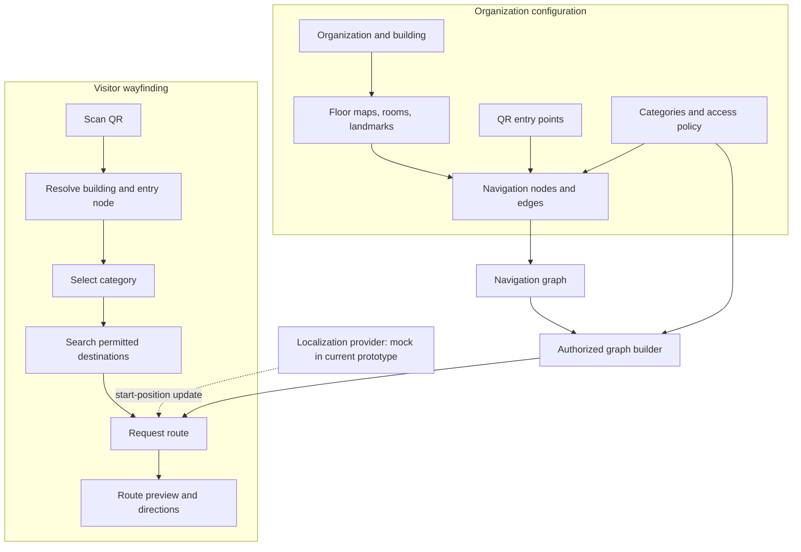

# NaviSense: QR-Enabled, Role-Aware Indoor Wayfinding with Graph-Based Route Planning

**Manuscript status:** Research draft for development and evaluation. Replace all bracketed fields and results tables with verified data before submission.  
**Author:** [Author name(s)]  
**Affiliation:** [Department, institution, city, country]  
**Corresponding author:** [Email]

## Abstract

Indoor wayfinding remains difficult in large, multi-floor facilities where satellite positioning is unreliable and static maps do not provide route-specific instructions. This paper presents NaviSense, a QR-started indoor wayfinding platform prototype designed for environments such as colleges, hospitals, offices, and public buildings. NaviSense organizes building information into floors, rooms, landmarks, navigation nodes, walkable edges, and QR entry points. A visitor can open a building-specific context, search for a destination, preview a route, and receive floor-aware instructions. A central design extension is role-aware navigation: the destinations visible to a visitor and the corridors traversable by a route planner should depend on an organization-configured category, such as student, parent, patient, visitor, clinician, or staff member. We formulate this requirement as route search over a category-specific authorized graph, rather than as interface-only destination hiding. The current repository contains a React/TypeScript prototype and a Dijkstra-style route search; localization is simulated and should not be interpreted as measured positioning performance. We propose a reproducible evaluation comparing Dijkstra and A* using route-cost agreement, expanded nodes, runtime, route validity, and permission-safety metrics. **No comparative performance result is claimed in this draft until the A* implementation, benchmark harness, and experiments have been executed.** The paper documents the system, mathematical model, research questions, test plan, limitations, and reporting templates required for a defensible evaluation.

**Keywords—** indoor navigation, wayfinding, QR code, graph search, Dijkstra, A*, access-aware routing, role-based destination discovery, multi-floor navigation.

---

## I. Introduction

People entering unfamiliar buildings may need to locate rooms, departments, clinics, services, lecture halls, elevators, or exits. Indoor wayfinding is challenging because satellite-based positioning may be unavailable or inaccurate indoors, floor layouts are complex, and a static map does not necessarily provide a route that is easy to follow. Prior surveys describe a broad set of indoor positioning and wayfinding approaches, including radio-frequency, vision-based, inertial, and infrastructure-assisted methods [1], [2]. The choice of positioning technology is only one part of a usable system: a wayfinding application also needs a spatial model, route planner, and human–computer interface.

NaviSense explores a low-friction entry workflow in which a visitor scans a QR code associated with an organization, building, floor, and entry point. The visitor can then search for a destination and receive a graph-based route. The system is designed for different building types, including colleges and hospitals, where different categories of people may need different destination lists and traversal permissions.

This paper focuses on three linked challenges. First, the building interior must be represented as a graph that can connect rooms, corridors, intersections, landmarks, entrances, and vertical transitions. Second, route planning should be evaluated transparently rather than assuming that one graph-search algorithm is always best. Third, the application must distinguish *discoverability* from *traversability*: a destination may be hidden from a category, and a route must not pass through a corridor or node that category is not allowed to use.

### A. Research questions

- **RQ1:** Under the same non-negative edge-cost model, can A* reduce search effort compared with Dijkstra while preserving optimal route cost?
- **RQ2:** Can category-specific graph filtering prevent routes from traversing restricted nodes and edges?
- **RQ3:** How do route success, expanded nodes, runtime, and route cost change as graph size, floor transitions, and access restrictions vary?

### B. Contributions

This work contributes:

1. A QR-started, multi-floor indoor wayfinding architecture for a web-based visitor experience.
2. A graph representation that supports room destinations, landmarks, horizontal walking links, and vertical floor transitions.
3. A role-aware routing formulation that restricts both destination visibility and graph traversability.
4. A reproducible evaluation protocol for comparing Dijkstra and A* and testing access-policy correctness.
5. An explicit separation between implemented prototype behavior, proposed extensions, and measurements that still need to be collected.

### C. Scope

NaviSense is a research prototype, not a certified safety system. The repository currently uses mock/sample map data, and the localization module simulates location states rather than measuring real-world position. The current routing implementation uses Dijkstra-style search. A* comparison, category-aware graph enforcement, and measured performance claims must be treated as planned work until implementation and tests verify them.

## II. Literature Survey

### A. Indoor positioning and wayfinding

Kunhoth et al. survey indoor positioning and wayfinding systems and discuss approaches based on radio signals, computer vision, pedestrian dead reckoning, and other technologies [1]. Their review describes indoor navigation as a combination of positioning, route planning, and user interaction. This separation motivates NaviSense's architecture: the route planner and user interface are kept separate from the localization provider so that a future positioning method can be integrated without rewriting the entire visitor experience.

Jamshidi et al. review wayfinding in interior environments and identify factors such as spatial memory, floor-plan configuration, landmarks, signage, and maps [2]. These findings support representing recognizable places and transitions in the navigation network and presenting route instructions in context, rather than showing only an abstract shortest-path line.

### B. Graph-based route planning

Dijkstra's algorithm computes shortest paths for graphs with non-negative edge costs [3]. Its result provides a useful baseline for indoor route planning because it does not require a heuristic. A* search uses an evaluation function combining the accumulated cost from the source and a heuristic estimate of the remaining cost [4]. If the heuristic is admissible and implementation assumptions are satisfied, A* can preserve optimality while potentially exploring fewer nodes. The actual gain depends on the graph structure, edge costs, heuristic, and implementation; it must be measured rather than assumed.

Park et al. compare algorithms for constructing indoor navigation network models and evaluate wayfinding quality using route efficiency and simplicity [5]. This reinforces that graph quality matters as much as the search algorithm. A route planner cannot compensate for missing corridors, disconnected nodes, incorrect vertical links, or inaccurate edge weights.

### C. QR-based entry context

QR codes offer an inexpensive way to associate a physical point with a digital context. In NaviSense, a QR code represents a configured organization/building/floor/entry point. It is not treated as continuous localization: after the scan, the application knows the encoded entry context, but it does not automatically know the visitor's subsequent physical position unless a separate positioning method is integrated.

### D. Access-aware navigation

A conventional shortest-path query assumes that all represented nodes and edges are traversable by the user. In facilities such as hospitals and laboratories, this assumption can be invalid. A visitor may be allowed to navigate to a public ward or reception but not to an intensive-care unit, staff-only room, or secure corridor. A student may access teaching spaces but not restricted administrative or laboratory areas.

NaviSense models this as a category-specific graph. The same base map can support different authorized subgraphs without duplicating the full map for each category. Destination filtering alone is insufficient: a route to a public destination must also avoid restricted intermediate corridors. Permission checks should be applied in trusted backend logic when server-side route APIs are available.

### E. Research gap and positioning

The reviewed work establishes the importance of positioning, graph modelling, and wayfinding quality [1], [2], [5], while classic graph-search literature provides the theoretical basis for Dijkstra and A* [3], [4]. NaviSense's focus is the integration of QR-based entry context, graph-based multi-floor routing, category-aware destination discovery, and edge-level traversal restrictions in a practical web prototype. The intended algorithmic comparison is an empirical study, not a claim that A* is inherently faster for every indoor map.

### Table I. Literature comparison

| Reference | Main focus | Relevance to NaviSense | Limitation for the present study |
|---|---|---|---|
| Kunhoth et al. [1] | Survey of indoor positioning and wayfinding | Separates positioning, route planning, and interaction | Survey does not benchmark this implementation |
| Jamshidi et al. [2] | Human/environment factors in indoor wayfinding | Supports landmarks and comprehensible instructions | Not a route-algorithm benchmark |
| Dijkstra [3] | Shortest-path algorithm | Baseline route search | No indoor-specific semantics |
| Hart et al. [4] | Heuristic minimum-cost path search | Theoretical basis for A* | Performance depends on graph and heuristic |
| Park et al. [5] | Indoor navigation network-model quality | Highlights graph quality and route simplicity | Does not evaluate NaviSense's category policy |

## III. System Overview

### A. Architecture

NaviSense separates map management, graph search, visitor interaction, and localization.

**Fig. 1.** Proposed NaviSense system architecture. The category and access-policy components describe the intended role-aware extension; implementation status must be verified before treating the diagram as an as-built architecture.

### B. Administrative model

The data hierarchy is organization → building → floor → rooms/landmarks/navigation network → QR entry points. Administrators configure locations and graph connectivity. Validation should detect missing room-to-node associations, disconnected graph components, invalid floor transitions, and QR points referencing non-existent nodes.

### C. Visitor workflow

1. Scan an active QR code.
2. Resolve the organization, building, floor, and entry node.
3. Select or confirm the category configured for the facility.
4. Search only destinations discoverable by that category.
5. Select a destination and request a route.
6. Receive a route preview and step/floor-aware guidance.
7. Receive a clear message if the destination is restricted or no authorized route exists.

The category-selection and access enforcement steps are target behavior until implemented and verified end-to-end.

### D. Current implementation notes

The repository uses React and TypeScript for the frontend. The route function in `src/lib/navisense/routing.ts` constructs an adjacency list from configured nodes and edges, uses Dijkstra-style search with a repeatedly sorted array queue, reconstructs a node path, and derives floor legs and turn instructions. The current localization module is mocked. Some administration flows use local mock state even though a Prisma schema and Express server are present.

## IV. Graph Model and Problem Formulation

Let the indoor navigation network be an undirected weighted graph:

[
G=(V,E,c)
]

where (V) is the set of navigation nodes, (E) is the set of walkable or vertical connections, and (c:E\rightarrow\mathbb{R}_{\geq 0}) assigns a non-negative traversal cost to each edge.

Each node (v\in V) has a floor identifier, coordinates in the floor-plan coordinate system, a semantic type, and a display label. Edges represent horizontal walking links or vertical transitions such as stairs and elevators.

Given source (s\in V) and target (t\in V), the path is (P=(v_0, v_1,\ldots,v_k)), where (v_0=s), (v_k=t), and each adjacent pair is connected by an edge. Its search cost is:

[
C(P)=\sum_{i=0}^{k-1} c(v_i,v_{i+1})
]

The objective is to find a feasible path minimizing (C(P)).

### A. Current edge-weight caveat

In the current implementation, horizontal edge costs are Euclidean distances between floor-plan coordinates. Vertical edges use a fixed search penalty of 220 units. Displayed walking distance is separately calculated from horizontal path segments and converted using a constant scale of 11 floor-plan units per metre. Thus, the search objective is not identical to displayed physical walking distance for multi-floor routes. Before a physical shortest-distance claim is made, edge costs should be expressed in a consistent unit or the objective should be explicitly defined as a generalized cost.

### B. Dijkstra's algorithm

Dijkstra maintains a tentative cost (g(v)) from the source. At each iteration it expands the unsettled node with minimum (g(v)), then relaxes outgoing edges:

[
g(v)\leftarrow\min\{g(v),g(u)+c(u,v)\}
]

It is optimal for non-negative edge weights. The current implementation uses repeated array sorting rather than a binary heap, which affects runtime and must be recorded in the benchmark.

### C. A* algorithm

A* prioritizes nodes using:

[
f(v)=g(v)+h(v)
]

where (g(v)) is the known cost from (s) to (v), and (h(v)) estimates the remaining cost to (t). A heuristic is admissible if it never overestimates the true remaining minimum cost. A Euclidean heuristic is only valid when the graph's edge costs and geometry make it a lower bound. Because the current graph includes a fixed vertical transition penalty and coordinates across floors may not be comparable, the heuristic must be defined and validated carefully. A safe initial heuristic could be zero, which reduces A* to Dijkstra, but would not demonstrate heuristic-guided savings. A practical non-zero heuristic must be proved or tested against the cost model.

### D. Category-specific authorized graph

Let (r) denote a visitor category. Define:

[
G_r=(V_r,E_r)
]

where (V_r\subseteq V) contains nodes that category (r) may traverse, and (E_r\subseteq E) contains edges allowed for that category. The allowed destination set is (D_r\subseteq V_r). A route query is valid only if the source and destination are permitted and a path exists in (G_r).

A destination may be discoverable but unreachable because all connecting corridors are restricted. The application must distinguish:
- destination not authorized;
- destination authorized but no permitted path exists;
- valid route found.

The route planner must operate on (G_r). Filtering the destination list while searching the unrestricted (G) does not satisfy the safety requirement.

### E. Complexity

For a graph with (|V|) vertices and (|E|) edges, Dijkstra with a binary heap is commonly (O((|V|+|E|)\log |V|)). The current repeated-sort queue does not have that implementation bound; its practical cost depends on queue size and repeated sorting. A* has a similar worst-case exponential behavior in general search settings, while its actual performance depends on the heuristic and graph. Runtime and node expansions should be reported empirically for the implementations being compared.

## V. Algorithmic Procedure

### Algorithm 1: Authorized route query

**Input:** base graph (G=(V,E)), category (r), source (s), target (t), node/edge permission policy.  
**Output:** valid route, unauthorized result, or no-authorized-path result.

1. Validate that (s) and (t) exist in the selected building graph.
2. Check whether the category is allowed to use the source and destination.
3. Build or query the category-specific node and edge permissions.
4. Remove/skip every node and edge not allowed for category (r).
5. If the target is not discoverable or permitted, return a not-authorized response.
6. Run the selected shortest-path algorithm on the permitted graph only.
7. If no path is found, return a no-permitted-route response.
8. Validate that every returned node and edge is permitted.
9. Reconstruct floor legs, direction steps, and vertical transitions.
10. Return the route and explanatory metadata.

### Algorithm 2: A* search (planned implementation)

1. Initialize (g(s)=0), (f(s)=h(s,t)), and predecessor of (s) as undefined.
2. Insert (s) into the open priority queue.
3. While the queue is not empty, remove the node (u) with minimum (f(u)).
4. If (u=t), reconstruct the path using predecessor links.
5. For each permitted neighbor (v), compute (g_{new}=g(u)+c(u,v)).
6. If (g_{new}<g(v)), update (g(v)), predecessor, and (f(v)=g(v)+h(v,t)); insert/update (v).
7. If the queue becomes empty, return no permitted path.

The implementation must handle stale queue entries, reopened nodes if required by the chosen heuristic assumptions, disconnected graphs, and invalid source/target identifiers.

## VI. Experimental Methodology

### A. Experimental design

The evaluation should use three dataset classes and label them separately:

1. **Repository mock graph:** the sample graph distributed with NaviSense.
2. **Generated graphs:** reproducible synthetic indoor-like graphs with controlled node count, branching, floor transitions, and restricted edges.
3. **Real mapped building graph (optional but recommended):** a manually verified floor plan with a documented node/edge inventory and permission policy.

Synthetic data must not be presented as a real-building user study. If the repository mock graph is too small to provide a meaningful algorithm comparison, use generated graphs for scaling and retain the repository graph for end-to-end correctness tests.

### B. Independent variables

- Graph size (|V|) and edge count (|E|).
- Number of floors and vertical transitions.
- Source-target separation.
- Percentage of restricted nodes/edges.
- Search algorithm (Dijkstra versus A*).
- Heuristic type and weight consistency.

### C. Dependent variables

- Route found / route success.
- Route-cost agreement between algorithms.
- Expanded nodes.
- Runtime per query (milliseconds).
- Valid-route rate.
- Unauthorized destination exposure count.
- Number of forbidden edges in generated routes.
- Correct no-route and not-authorized responses.

### D. Procedure

1. Freeze the commit hash and record software/hardware versions.
2. Generate or select the graph corpus using fixed seeds.
3. Verify graph connectivity and edge-cost validity.
4. Run a warm-up phase not included in timing summaries.
5. Execute each source-target query multiple times for both algorithms.
6. Record raw trial-level values in CSV; report median and interquartile range or mean and standard deviation as appropriate.
7. Compare route costs and validate every returned edge against the source graph and permission policy.
8. Repeat the policy tests for public, restricted, disconnected, and cross-floor routes.
9. Save the benchmark script, raw data, and figure-generation script with the paper artifacts.

### E. Baselines and acceptance criteria

- Dijkstra is the shortest-path baseline.
- A* must return the same optimal search cost as Dijkstra for every tested query where both complete successfully.
- No returned route may contain a forbidden node or edge.
- No restricted destination may be exposed in category-filtered search results.
- Unauthorized and no-route states must be distinguishable.
- A* efficiency is a measured outcome, not an acceptance guarantee; it may not outperform Dijkstra on every graph.

## VII. Results

**Important: this section is intentionally a reporting template. No measured values are available in this manuscript draft. Populate it only after the experiment is run.**

### A. Algorithm comparison

**Table II. Route-planning benchmark results**

| Dataset | Nodes (|V|) | Edges (|E|) | Queries | Algorithm | Median runtime (ms) | Median expanded nodes | Mean/median path cost | Optimal-cost agreement |
|---|---:|---:|---:|---|---:|---:|---:|---:|
| [Mock / generated / real] | [N] | [M] | [Q] | Dijkstra | [measure] | [measure] | [measure] | Baseline |
| [same dataset] | [N] | [M] | [Q] | A* | [measure] | [measure] | [measure] | [measure] |

### B. Access-policy tests

**Table III. Permission correctness**

| Test case | Expected result | Observed result | Pass/fail |
|---|---|---|---|
| Public destination, public route | Route returned | [measure] | [result] |
| Restricted destination | Not-authorized response | [measure] | [result] |
| Public destination behind restricted corridor | No permitted route or approved alternate | [measure] | [result] |
| Alternative authorized route exists | Only authorized route returned | [measure] | [result] |
| Disconnected target | No-route response | [measure] | [result] |
| Cross-floor route using permitted elevator/stairs | Valid floor transition | [measure] | [result] |

### C. Graphs to generate from measured CSV data

1. **Runtime vs. graph size:** line chart with separate Dijkstra and A* series; plot median runtime and error bars/intervals.
2. **Expanded nodes vs. graph size:** line chart showing search effort.
3. **Relative runtime:** grouped bar chart or box plot by graph class.
4. **Path-cost agreement:** paired plot of Dijkstra and A* route costs; any discrepancy requires investigation.
5. **Access-policy outcomes:** bar chart of passed/failed permission tests, based on actual test counts.
6. **Route composition:** optional pie/donut chart for proportions of horizontal walking edges and vertical transitions in a documented dataset. Do not use a pie chart for algorithm speed when a bar/line chart is more meaningful.

No chart should contain invented measurements. A figure caption must state the dataset, number of queries, algorithm version, hardware, and summary statistic.

## VIII. Discussion

The proposed architecture makes QR codes useful as entry-context anchors without claiming that QR scanning tracks a visitor continuously. The graph model can provide interpretable route instructions, but its quality depends on accurate floor maps and complete connectivity. Incorrect node coordinates, missing edges, or inappropriate edge weights can invalidate shortest-path results even when the algorithm is implemented correctly.

Role-aware navigation adds a separate correctness requirement. A route can be mathematically shortest and still be operationally inappropriate if it crosses a restricted corridor. Therefore, route optimality and permission safety must be evaluated independently. A successful system should return a shortest route *within the authorized graph*, not merely a shortest route in the unrestricted building graph.

A* may reduce node expansions when a useful admissible heuristic directs search toward the goal. However, a poorly matched heuristic can offer little benefit, and a heuristic that overestimates remaining cost can compromise optimality. The current fixed vertical edge penalty and floor-plan coordinate system need a consistent cost model before selecting a heuristic. The comparison should report the exact heuristic and implementation details.

### Threats to validity

- **Construct validity:** expanded nodes and runtime capture algorithmic effort but do not directly measure visitor usability or safety.
- **Internal validity:** runtimes are sensitive to machine load, runtime warm-up, data structure choice, and language/runtime overhead.
- **External validity:** synthetic or mock maps may not represent real hospital or campus layouts.
- **Model validity:** the current displayed distance excludes the fixed vertical search penalty; search cost and physical distance should not be conflated.
- **Policy validity:** category permissions require review by facility owners; example rules are not a substitute for real institutional policy.
- **Positioning validity:** simulated localization states do not establish real-world localization accuracy.

## IX. Limitations and Ethics

The current prototype has important limitations. Localization is mocked; no real sensor accuracy has been measured. The sample floor-plan and navigation data are not evidence of performance in a deployed building. Some administrative flows use client-side mock state. The route function currently implements Dijkstra-style search and uses a repeatedly sorted array queue. A* and role-aware edge filtering must be implemented and tested before results are reported.

A QR code should not be treated as a secure identity credential. A visitor may photograph or share a QR code, and public context does not prove a person's role. Sensitive categories should use a trusted authorization flow if access to confidential destinations matters. Navigation software also cannot enforce a physical boundary; signage, staff procedures, door controls, and emergency protocols remain authoritative.

A hospital deployment must not reveal sensitive room details to unauthorized users. Permission models should be configured with facility administrators, audited, and tested against route leakage. The system should avoid implying that route instructions supersede emergency instructions or clinical staff directions.

## X. Conclusion and Future Work

This paper presents NaviSense as a QR-started, graph-based indoor wayfinding prototype and proposes an evaluation of route planning and role-aware navigation. The key design principle is to build routes on a category-specific authorized graph so that both destinations and intermediate corridors respect access policy. The current repository provides a starting point with a React/TypeScript visitor and administrator experience, sample indoor graph data, and Dijkstra-style routing.

The next steps are to implement and test category-configurable node/edge permissions, add A* with a validated heuristic, make route cost units consistent, automate route and access-policy tests, and run reproducible benchmarks. Only after these steps should measured results, graphs, and conclusions about speed or correctness be added. Real-building and user studies would then be needed to evaluate usability, map accuracy, and operational suitability.

---

## References

[1] J. Kunhoth, A. Karkar, S. Al-Maadeed, and A. Al-Ali, “Indoor positioning and wayfinding systems: a survey,” *Human-centric Computing and Information Sciences*, vol. 10, article 18, 2020, doi: [10.1186/s13673-020-00222-0](https://doi.org/10.1186/s13673-020-00222-0).

[2] S. J. Jamshidi, M. Ensafi, and D. Pati, “Wayfinding in Interior Environments: An Integrative Review,” *Frontiers in Psychology*, vol. 11, 2020, doi: [10.3389/fpsyg.2020.549628](https://doi.org/10.3389/fpsyg.2020.549628).

[3] E. W. Dijkstra, “A note on two problems in connexion with graphs,” *Numerische Mathematik*, vol. 1, pp. 269–271, 1959, doi: [10.1007/BF01386390](https://doi.org/10.1007/BF01386390).

[4] P. E. Hart, N. J. Nilsson, and B. Raphael, “A formal basis for the heuristic determination of minimum cost paths,” *IEEE Transactions on Systems Science and Cybernetics*, vol. 4, no. 2, pp. 100–107, 1968, doi: [10.1109/TSSC.1968.3001364](https://doi.org/10.1109/TSSC.1968.3001364).

[5] S. J. Park et al., “A comparison of network model creation algorithms based on the quality of wayfinding results,” *Transactions in GIS*, 2020, doi: [10.1111/tgis.12632](https://doi.org/10.1111/tgis.12632).

---

## Submission checklist

- [ ] Replace author and affiliation placeholders.
- [ ] Verify every reference against the publisher metadata and IEEE reference format.
- [ ] Implement A* and document its heuristic and data structure.
- [ ] Implement category-specific node and edge restrictions end-to-end.
- [ ] Add automated tests and save the test report.
- [ ] Run the benchmark and commit raw CSV files and figure-generation code.
- [ ] Replace every `[measure]` placeholder with actual measurements.
- [ ] Generate figures from recorded data, not hand-estimated values.
- [ ] Include software commit, hardware, runtime, dataset, seed, and repetition details.
- [ ] Have the manuscript reviewed by the project guide before submission.
