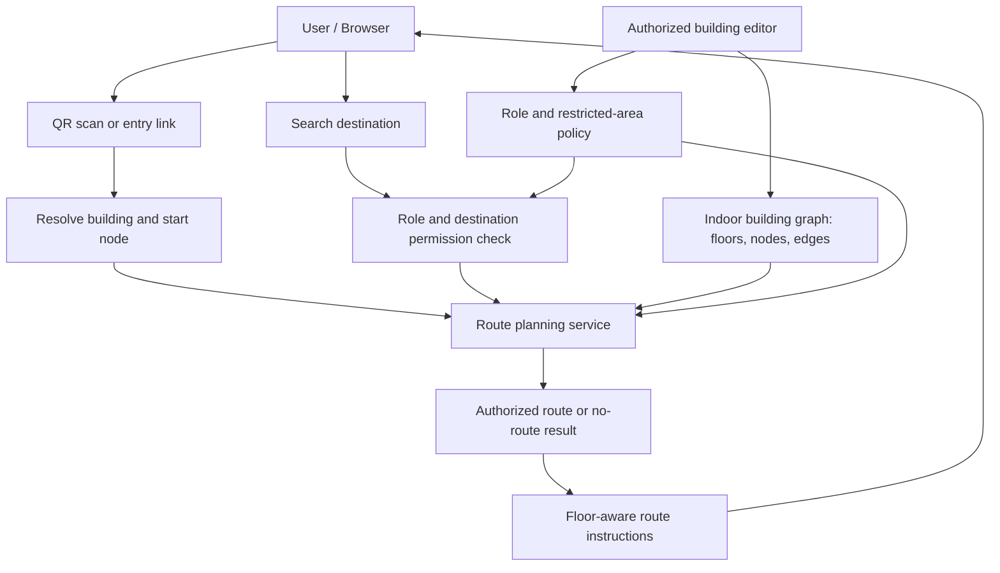
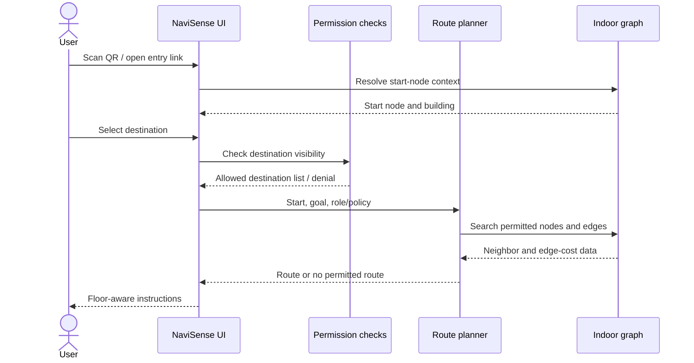
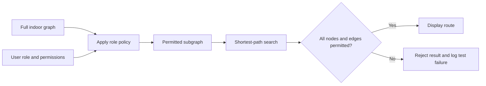

# NaviSense: QR-Enabled, Role-Aware Indoor Wayfinding with Graph-Based Route Planning

**Manuscript type:** System design and experimental evaluation paper  
**Draft status:** Results section populated from the supplied local benchmark reports; raw CSV/script verification and figure insertion remain before submission.  
**Author(s):** [Author name(s)]  
**Affiliation:** [Department, institution, city, country]  
**Corresponding author:** [Email]  
**Target template:** [Insert required IEEE / conference template and paper ID, if applicable]

> **Important before submission.** The results section has been populated from the supplied local benchmark reports. Verify every value against the raw CSVs and benchmarked commit, generate and insert only figures supported by those files, and clarify the permission-test counting unit. Localization remains mocked and some administrative state is client/mock state; do not imply continuous positioning or production-grade authorization. Replace every remaining bracketed field before submission.

## Abstract

Indoor wayfinding is challenging in multi-floor buildings because satellite-based positioning is often unreliable indoors and static maps do not provide route-specific guidance. This paper presents NaviSense, a QR-started indoor wayfinding prototype that models indoor circulation as a graph and investigates graph-search performance and role-aware route constraints. A controlled benchmark compared Dijkstra and A* over generated grid and graph-shape fixtures using 30 paired trials per query group. Route availability agreed in all 570 paired trials, and independently recomputed path costs matched in all 510 successful pairs. A* expanded fewer nodes in the six grid groups, but had higher median paired runtime in all reported grid and graph-shape groups. Deterministic permission fixtures reported no forbidden-edge traversals, although the tests do not establish production security because authorization remains prototype-level and client-side data may be exposed. Localization remains simulated, and the Engineering Block graph is mock data rather than a surveyed building. These results characterize the tested implementation and fixtures only; they do not establish real-world positioning accuracy, usability, or general algorithm superiority.

**Keywords—** indoor navigation, indoor wayfinding, QR code, graph algorithms, Dijkstra's algorithm, A* search, role-based access control, route planning, web application.

---

## I. Introduction

Indoor wayfinding requires a system to identify a starting point, represent navigable spaces, compute a valid route, communicate floor transitions, and respect access restrictions. Satellite positioning is often unreliable indoors, while infrastructure-heavy positioning methods can add cost and maintenance. NaviSense instead uses a QR scan to establish an entry context; this does not provide continuous positioning after the scan [1]–[4], [6], [13].

The shortest geometric route is not necessarily an authorized route. Restricted rooms, corridors, or floor transitions require destination filtering and graph-level traversal constraints. NaviSense is a web-based prototype that models indoor spaces as a graph and evaluates Dijkstra and A* routing alongside role-aware destination and route checks. The study evaluates the tested software and graph fixtures; it does not claim that these components are individually novel or that the prototype provides production-grade security.

### A. Research questions

- **RQ1:** How do Dijkstra and A* compare in runtime, expanded nodes, route availability, and route cost on identical graph/query inputs?
- **RQ2:** Do destination filtering and route constraints prevent restricted destinations from appearing and forbidden edges from being traversed?
- **RQ3:** How do graph size and query type affect the observed planner performance?

### B. Contributions

This paper documents a QR-started indoor wayfinding architecture, defines a graph model that separates search cost from displayed distance, reports a controlled Dijkstra/A* benchmark, and evaluates role-aware destination and route restrictions using deterministic fixtures.

---

## II. Literature Survey and Related Work

Indoor positioning research covers radio-frequency, Wi-Fi, visual, inertial, and hybrid approaches, each with trade-offs in cost, accuracy, and maintenance [1]–[4], [6], [13]. Wayfinding research also emphasizes that a valid path must be communicated clearly through spatial cues and instructions; graph correctness alone does not establish usability [5]. NaviSense therefore treats QR scanning as a start-context mechanism rather than continuous localization and leaves usability evaluation for future work.

QR-assisted path planning and indoor navigation-network research motivate representing navigable connections explicitly rather than treating a floor plan as an unstructured image [7]–[9], [14], [15]. Nodes represent navigable points, edges represent connections, and stairs or lifts must be modeled as explicit transitions. Route quality depends on the completeness and accuracy of this graph.

Dijkstra's algorithm computes shortest paths for graphs with non-negative edge weights [10]. A* adds a heuristic estimate of remaining cost and can reduce search effort when the heuristic is suitable [11]. Neither algorithm should be assumed faster without measurement because runtime depends on graph topology, heuristic quality, and implementation details.

Role-based access control associates permissions with roles [12]. For indoor navigation, destination visibility and graph traversability are distinct: hiding a destination does not prevent a route from passing through a restricted corridor. Both checks are needed. Client-side or mock-state filtering is not a production security boundary; sensitive authorization must be validated by a trusted server.

### Research gap

Prior work provides foundations for indoor positioning, wayfinding, graph construction, shortest-path search, and access control. This paper evaluates their combination in a QR-started web prototype, focusing on measured graph-search behavior and functional role-aware route validity. It does not claim that a systematic review has established this combination as novel.

---

## III. Problem Definition

Represent the indoor environment as a weighted graph (G=(V,E,w)), where V contains navigation nodes, E contains connections, and each edge has a non-negative search cost w(e). The scanned QR marker supplies a start node s, and the requested destination is t.

For role r, let V_r and E_r be the permitted nodes and edges. The planner must return a path using only the permitted subgraph G_r = (V_r, E_r), or report that no permitted route exists.

[
P^* = \arg\min_{P\in\mathcal{P}_{G_r}(s,t)}
\sum_{e\in P} w(e)
]

Here, P_{G_r}(s,t) is the set of permitted paths from s to t. If this set is empty, no authorized route exists.

The scope is software route planning and functional access-aware behavior. Continuous localization accuracy, usability, emergency-routing certification, and production security are outside the claims of this evaluation.

---

## IV. Proposed NaviSense System

### A. System overview

NaviSense connects a browser interface to an indoor graph. A QR marker or building-specific link establishes the start context; the user selects an available destination, the planner searches the permitted graph, and the interface displays the route and floor transitions or reports that no permitted route exists.

### Figure 1. High-level system architecture



**Figure 1 caption:** Conceptual architecture of QR-started indoor wayfinding. Server-side enforcement is an intended design requirement, not proof that all current prototype paths are enforced server-side.

### B. Main data entities

| Entity | Purpose |
|---|---|
| Building / floor | Groups the navigation environment and its levels |
| Room / destination | Represents a searchable endpoint and its visibility policy |
| Navigation node | Represents a navigable point or junction |
| Edge | Connects nodes and stores cost, transition type, and restriction metadata |
| QR entry point | Maps a marker or link to a building and start node |
| Role / policy | Defines permitted destinations, nodes, and edges |

This is a conceptual summary; align entity names and fields with the final repository schema before submission.

### C. QR entry and user workflow

A QR code identifies a known building or start node; it does not continuously track the user after scanning. The intended workflow is: open NaviSense, scan or follow an entry link, resolve the start node, choose an authorized destination, compute a route through permitted connections, and display floor-aware instructions or a no-route message.

### Figure 2. User and route-planning sequence



**Figure 2 caption:** Intended interaction sequence. Production deployment requires trusted-server authorization; client-side filtering alone is insufficient.

---

## V. Mathematical Model and Route-Planning Algorithms

### A. Indoor graph

The indoor environment is represented as a graph (G=(V,E)). A node (v\in V) corresponds to a navigable point, such as a corridor junction, entrance, stair landing, lift lobby, or destination connection. An edge (e=(u,v)\in E) indicates that movement between two nodes is permitted by the building model. Edge metadata may identify horizontal corridors, stairs, lifts, ramps, or other transitions.

The current routing code calculates horizontal edge cost from Euclidean coordinate differences and applies a fixed search penalty of 220 to vertical transitions. Separately, the displayed physical distance is calculated from horizontal segments using a scale of 11 floor-plan units per metre. Thus, **search cost and displayed physical distance are not the same quantity**. The paper must report them separately and must not describe the search penalty as metres. The constants should be documented and sensitivity-tested before a final study.

For horizontal nodes (u=(x_u,y_u)) and (v=(x_v,y_v)), a Euclidean segment length is:

\[
d_h(u,v)=\sqrt{(x_v-x_u)^2+(y_v-y_u)^2}
\]

If the current implementation applies a fixed vertical-transition penalty, the search cost can be represented as:

\[
w(u,v)=
\begin{cases}
d_h(u,v), & \text{horizontal edge}\
c_v, & \text{vertical transition}
\end{cases}
\]

where (c_v=220) is the current implementation's search penalty, subject to confirmation against the current source code. This is a software search weight, not a calibrated physical travel distance. A future model could use empirically calibrated costs for stairs, lifts, ramps, accessibility needs, or expected travel time.

### B. Dijkstra baseline

Dijkstra's algorithm maintains the best known cost from the start node to each discovered node. It repeatedly selects the unsettled node with the lowest accumulated cost, relaxes outgoing edges, and stops when the destination is finalized or no reachable nodes remain [10]. With non-negative edge weights, the algorithm returns a minimum-cost route.

The current NaviSense implementation uses a Dijkstra-style search and repeatedly sorts an array to select the next node. This is important to performance interpretation. The conventional binary-heap implementation has a different complexity profile from repeated sorting. The experiment should report the actual data structure used rather than presenting a complexity claim that does not match the code.

### C. A* extension

A* prioritizes nodes using:

\[
f(n)=g(n)+h(n)
\]

where (g(n)) is the known cost from the start to node (n), and (h(n)) estimates the remaining cost to the destination [11]. For a grid-like or coordinate-based indoor graph, a candidate heuristic is horizontal Euclidean distance to the destination. However, because the current implementation assigns a fixed penalty to vertical transitions and displayed distance uses a different scale, the heuristic must be checked against the actual edge-cost model. To preserve optimality, the heuristic must not overestimate the minimum remaining cost. If this condition cannot be established for the modeled graph, use a conservative admissible heuristic or explicitly evaluate the effect of the heuristic on optimality.

### D. Fair algorithm comparison

For a fair comparison:

- Run both algorithms on the same graph snapshots and query pairs.
- Use the same edge weights, role constraints, and start/goal nodes.
- Verify that both return the same optimal cost on graphs with non-negative weights.
- Report priority-queue/data-structure details for both implementations.
- Record runtime and expanded nodes separately.
- Repeat each query several times and report median and spread; do not rely on a single timing.
- Include unreachable destination cases and multi-floor queries.
- Fix random seeds for generated graphs and publish the configuration.

### Figure 3. Route-planning process

```mermaid
flowchart TD
    A[Start node from QR context] --> B[Destination selected]
    B --> C[Validate start, goal, and role]
    C --> D[Build permitted graph]
    D --> E{Algorithm}
    E --> F[Dijkstra: priority by g(n)]
    E --> G[A*: priority by g(n) + h(n)]
    F --> H[Reconstruct predecessor path]
    G --> H
    H --> I{Path valid and permitted?}
    I -- Yes --> J[Return route and floor transitions]
    I -- No --> K[Return no permitted route / error]
```

**Figure 3 caption:** Proposed route-planning flow. The A* branch is an experimental extension and should only be described as implemented after the code and tests confirm it.

---

## VI. Role-Based Destination Filtering and Restricted-Area Routing

### A. Permission model

For a role r, let D_r denote discoverable destinations, V_r permitted navigation nodes, and E_r permitted edges. A destination is selectable only if t ∈ D_r, and a route P is valid only if every node and edge in the path is permitted:

[
\forall v\in P,\; v\in V_r
\qquad\text{and}\qquad
\forall e\in P,\; e\in E_r
]

Destination visibility and traversal permissions are separate policies. A user may be allowed to use a public corridor without being allowed to discover every connected room.

### B. Enforcement requirements

The planner must validate the start node, exclude forbidden nodes and edges from route search, and return no permitted route when restrictions disconnect the start and destination. A final route should be checked against the applicable policy. In production, the server must validate identity, role, destination, and route constraints on every request; client-side state is not a trusted security boundary.

### Figure 4. Role-aware route filtering



**Figure 4 caption:** Role-aware routing searches the permitted subgraph and validates the final path. The diagram describes the target behavior; the measured functional results are reported in Section IX.

---

## VII. Implementation Details

NaviSense is a web application with a client-side interface, routing/localization modules, a Prisma schema, and Express-related server components. Record exact framework and dependency versions from the package manifests for the final benchmarked commit.

The reported benchmark compares Dijkstra and A* using the same binary min-heap and stale-entry handling. Localization remains mocked, QR scanning supplies only an entry context, and some administrative or authorization state is client/mock state. The fixed vertical-transition penalty is a search-cost parameter, not a physical distance. These implementation boundaries constrain the claims made from the results.

For reproducibility, archive the exact source commit, operating system and hardware, runtime version, graph-generation scripts and seeds, graph/query definitions, algorithm and priority-queue versions, warm-up and trial counts, timing method, raw CSVs, and figure-generation commands.

---

## VIII. Experimental Setup and Evaluation Metrics

The evaluation covers (1) route correctness and role-policy behavior, and (2) paired Dijkstra/A* performance on identical graph/query inputs. The reported fixtures include generated grid graphs, graph-shape cases, and deterministic permission scenarios.

The independent variables are algorithm, graph topology and size, and query type (same-floor, cross-floor, short, long, or unreachable). The measured metrics are runtime, expanded nodes, route availability, independently verified route cost, destination visibility, and forbidden-edge traversal. Search cost and application-displayed distance are recorded as distinct quantities.

Timed trials use the same graph and query for both algorithms. Route outputs are checked independently, and results are summarized with medians and interquartile ranges. The benchmark procedure, machine/runtime details, timing boundaries, and trial counts are reported alongside the results in Section IX to avoid duplicating those details here. No restriction-density sweep is claimed unless fixed queries have actually been tested across predeclared restriction levels.

---

## IX. Results and Analysis

The results below are transcribed from the supplied local benchmark reports. The grid and graph-shape tests use generated fixtures; the Engineering Block graph is mock data, not a surveyed building. These are software benchmark results, not real-world navigation or user-study results.

### A. Correctness results

**Table II. Route-planning correctness results**

| Test group | Paired trials / cases | Result | Interpretation |
|---|---:|---|---|
| Grid graph route availability | 180 | 180/180 agreed | Algorithms agreed on route-found/no-route status |
| Graph-shape route availability | 390 | 390/390 agreed | Algorithms matched expected reachable/unreachable status |
| Successful grid path costs | 180 | 180/180 matched | Independently recomputed costs agreed |
| Successful graph-shape path costs | 330 | 330/330 matched | Independently recomputed costs agreed |
| All successful benchmark pairs | 510 | 510/510 matched | No path-cost disagreement observed |
| Permission fixtures | See Table IV | No forbidden-edge traversals reported | Deterministic prototype tests only |

Across 570 paired benchmark trials (180 grid and 390 graph-shape), route availability agreed in every trial. All 510 successful paired routes had independently recomputed matching minimum costs. The remaining 60 pairs were unreachable cases, for which route-cost agreement is not applicable.

**[INSERT FIGURE 8 HERE — Route-cost agreement, only if paired raw costs are available]**

- Chart: scatter plot with Dijkstra route cost on the x-axis and A* route cost on the y-axis; add a reference line y=x.
- Data: paired successful-query costs from routing-benchmarks.csv and graph-shape-benchmarks.csv.
- Do not invent individual points from aggregate summaries. If paired raw costs are unavailable, omit this figure.
- Caption: “Dijkstra and A* route costs for matched successful queries. Points on the equality line indicate matching route costs.”

### B. Performance results — grid graphs

**Table III. Route-planning performance on generated grid graphs**

Runtime values are median milliseconds with interquartile range (Q1–Q3). Paired change is the median of per-trial percentage changes, with its Q1–Q3 interval. Positive change means A* took longer.

| Nodes | Query type | Dijkstra runtime, median [Q1, Q3] ms | A* runtime, median [Q1, Q3] ms | Paired runtime change, median [Q1, Q3] | Expanded nodes Dijkstra / A* |
|---:|---|---:|---:|---:|---:|
| 300 | Same floor | 0.8807 [0.7517, 1.0945] | 0.9830 [0.9002, 1.2964] | +11.3% [+0.2%, +28.1%] | 100 / 83 |
| 300 | Cross floor | 1.0894 [1.0257, 1.3851] | 1.1673 [1.0437, 1.3799] | +3.4% [-6.4%, +12.1%] | 295 / 208 |
| 1,200 | Same floor | 1.4127 [1.3318, 1.6127] | 2.0846 [1.9288, 2.3910] | +42.5% [+23.8%, +61.0%] | 400 / 363 |
| 1,200 | Cross floor | 2.8198 [2.1476, 3.3207] | 3.2779 [2.6293, 3.9500] | +21.5% [-5.4%, +39.2%] | 1,195 / 885 |
| 2,700 | Same floor | 3.2775 [3.1735, 3.9057] | 4.4150 [4.2530, 4.6389] | +31.7% [+13.2%, +46.3%] | 985 / 843 |
| 2,700 | Cross floor | 5.4790 [4.9581, 6.2110] | 6.7552 [5.7309, 7.3924] | +20.6% [-0.4%, +43.0%] | 2,695 / 1,921 |

**[INSERT FIGURE 5 HERE — Runtime by grid size]**

- Chart: line chart with markers and Q1–Q3 error bars; separate panels for same-floor and cross-floor queries.
- X-axis: node count (300, 1,200, 2,700). Y-axis: median runtime (ms). Series: Dijkstra and A*.
- Data: routing-benchmarks.csv.
- Caption: “Median routing runtime by grid size and query type; error bars show the interquartile range across 30 paired trials.”

**[INSERT FIGURE 6 HERE — Expanded nodes by algorithm]**

- Chart: line chart with markers; separate same-floor and cross-floor panels.
- X-axis: node count. Y-axis: median expanded nodes. Series: Dijkstra and A*.
- Data: routing-benchmarks.csv.
- Caption: “Expanded nodes by graph size and query type. A* expanded fewer nodes in all six grid groups.”

**Results interpretation:** Across the six grid groups, A* matched Dijkstra’s independently recomputed path cost in all 180 paired trials and expanded fewer nodes in each group. However, A* had a higher median paired runtime in every group, ranging from +3.4% to +42.5%. For the 2,700-node same-floor query, A* expanded 843 nodes compared with 985 for Dijkstra, but median runtime was 4.4150 ms compared with 3.2775 ms. Fewer expansions therefore did not translate into lower end-to-end runtime under these tested conditions. The paired runtime IQR includes zero in some groups, so these descriptive results alone do not establish statistical significance.

### C. Performance results — graph shapes

**Table V. Runtime across graph shapes and query types**

Runtime values are median milliseconds. The paired-change interval is Q1–Q3 across paired per-trial percentage changes. Preserve the full runtime IQR, expanded-node counts, and examined-edge counts in the supplementary benchmark report.

| Graph / query | Nodes | Dijkstra median (ms) | A* median (ms) | Paired runtime change, median [Q1, Q3] | Cost agreement |
|---|---:|---:|---:|---:|---:|
| Corridor tree — long | 160 | 0.7567 | 0.8649 | +14.3% [+2.7%, +42.0%] | 30/30 |
| Corridor tree — short | 160 | 0.2812 | 0.3527 | +39.2% [-1.0%, +63.1%] | 30/30 |
| Irregular floor plan — long | 120 | 0.5554 | 0.6253 | +12.1% [+8.1%, +20.6%] | 30/30 |
| Irregular floor plan — short | 120 | 0.3304 | 0.4079 | +26.3% [+11.5%, +35.2%] | 30/30 |
| Engineering Block mock — cross-floor | 61 | 0.2437 | 0.2994 | +11.1% [-7.6%, +31.5%] | 30/30 |
| Engineering Block mock — long | 61 | 0.1436 | 0.1668 | +17.0% [+10.3%, +25.9%] | 30/30 |
| Engineering Block mock — short | 61 | 0.1690 | 0.1902 | +18.0% [+11.5%, +30.8%] | 30/30 |
| Engineering Block mock — unreachable | 61 | 0.0168 | 0.0169 | +1.8% [-6.9%, +23.7%] | N/A |
| Obstacle-heavy — long | 324 | 1.3274 | 1.5212 | +17.2% [+6.2%, +30.7%] | 30/30 |
| Obstacle-heavy — short | 324 | 0.6311 | 0.7611 | +20.4% [+14.2%, +36.0%] | 30/30 |
| Sparse-disconnected — long | 60 | 0.0492 | 0.0654 | +31.1% [+20.6%, +37.4%] | 30/30 |
| Sparse-disconnected — short | 60 | 0.0317 | 0.0482 | +43.3% [+31.9%, +67.7%] | 30/30 |
| Sparse-disconnected — unreachable | 60 | 0.1155 | 0.1315 | +14.7% [+8.5%, +18.1%] | N/A |

Across 390 paired graph-shape trials, route availability agreed with the expected result in every trial. All 330 successful pairs had matching independently recomputed path costs. Unreachable queries are excluded from path-cost agreement.

**[INSERT FIGURE 7 HERE — Paired runtime change by graph shape]**

- Chart: horizontal dot plot with horizontal Q1–Q3 error bars and a vertical reference line at 0%.
- X-axis: median paired runtime change (%); positive values mean A* was slower. Y-axis: the 13 graph/query groups in Table V.
- Data: graph-shape-benchmarks.csv.
- Caption: “Median paired runtime change across graph-shape queries; error bars show the interquartile range of paired per-trial percentage changes.”

**Results interpretation:** A* had a higher median paired runtime in all 13 graph-shape groups. It generally expanded fewer nodes in reachable queries, but the reduction varied by graph structure and route length. These results apply only to the generated fixtures and recorded runtime environment. The Engineering Block graph is mock data, not a surveyed building.

### D. Role-aware destination and route tests

**Table IV. Role-aware navigation outcomes**

| Scenario | Expected staff result | Expected visitor result | Reported outcome |
|---|---|---|---|
| Authorized alternative | Route available | Route available only if permitted | Scenario passed for tested roles and algorithms |
| Missing floor transition | No route | No route | Expected no-route decision passed |
| No permitted route | Route available | No permitted route | Expected role-specific decision passed |
| Restricted destination | Route available | Denied / destination hidden | Destination absent from visitor-filtered results |
| Restricted floor transition | Route available | No permitted route | Expected role-specific decision passed |
| Restricted node | Route available | No permitted route | Expected role-specific decision passed |

The supplied permission summary reports zero unauthorized routes among 12 generated routes, 12/12 expected no-route decisions passed, 12/12 authorized-route checks passed, restricted-destination visibility of 0/2 algorithm-cases in the visitor-filtered result set, and zero forbidden-edge traversals.

**Counting clarification required before submission:** six scenarios × two roles × two algorithms could produce 24 algorithm-level evaluations. The phrase “12 generated routes” may count route-producing cases rather than all evaluations. Reconcile the denominator against permission-benchmarks.csv and the test harness. Do not present these as a single overall pass rate until the counting unit is explicit.

**[INSERT FIGURE 9 HERE — Permission-test outcome counts, only if case-level data support it]**

- Chart: compact grouped bar chart of observed pass/fail counts by permission check, with sample counts displayed.
- Data: permission-benchmarks.csv and the corresponding test output.
- Only plot checks with explicit case-level outcomes. If only aggregate counts are available or the sample is too small, omit the chart and retain Table IV.
- Caption: “Observed outcomes of deterministic role-aware routing fixtures. Counts describe prototype functional tests and are not a security audit.”

**Security qualification:** The deterministic fixtures showed expected application-level behavior for the tested destination, node, and edge restrictions. No forbidden-edge traversal or unauthorized route was reported in the supplied summary. These results do not establish production-grade access control: mock data may remain inspectable in the browser bundle, and client-side filtering is not a trusted security boundary. Server-side route authorization and direct-API security testing remain necessary.

### E. Proposed analysis not supported by the current measurements

Do not generate the previously proposed “route availability versus restriction density” Figure 10 from the current results. The supplied summary does not establish a controlled sweep across multiple restricted-edge-density levels using fixed queries. Run and record that additional experiment before including such a chart; do not substitute invented or unrelated data.

### F. Experimental environment and timing procedure

The benchmark report records Node v22.20.0 on Windows 10 x64 (build 10.0.26300), AMD Ryzen 7 5825U, 16 logical CPUs, and approximately 16.5 GB RAM. Five warm-up runs alternated algorithm order, followed by 30 measured paired trials with alternating order. Timing used performance.now() around the complete computeRoute() call, including per-call policy filtering, adjacency construction, and heuristic setup. Graph construction, independent path-cost validation, CSV writing, and logging were outside the timed region. No timing outliers were discarded.

Dijkstra and A* used the same binary min-heap and stale-entry handling in this benchmark. Expanded nodes count valid, non-stale open-set removals, including the goal when reached. Examined edges count directed adjacency entries scanned while expanding those nodes. Runtime includes setup costs, so fewer expanded nodes do not guarantee lower end-to-end runtime.

### G. Route cost versus displayed distance

The optimizer minimizes the implementation’s generalized routingCost, not validated physical walking distance. Horizontal walk-edge cost uses Euclidean floor-plan units, while a vertical edge uses a fixed penalty of 220. The displayed NaviRoute.distance separately sums horizontal walk segments, divides by 11 floor-plan units per metre, and rounds; it excludes the vertical penalty and physical vertical travel. Route-cost optimality and displayed distance are therefore different metrics and must not be reported interchangeably.

### H. Reproducibility and files

The supplied local evaluation refers to routing-benchmarks.csv, graph-shape-benchmarks.csv, and permission-benchmarks.csv, along with research-evaluation-report.md and benchmark-report.md. Include the raw CSVs, benchmark scripts, report-generation scripts, and figures in the research branch or a versioned supplementary archive before submission. Record the exact commit SHA used for the final benchmark.

The local evaluation notes report 13 tests passing, TypeScript checking, focused linting, production build, benchmark scripts, summary scripts, and plot scripts completing. Re-run these commands on the final commit and retain their logs before claiming the results are reproducible from the published repository.
## X. Discussion, Limitations, and Threats to Validity

The results characterize the tested implementation and generated graph fixtures, not universal algorithm performance or real-building navigation quality. A* expanded fewer nodes in the reported grid groups but had higher median paired runtime across the reported groups, showing that fewer expansions do not guarantee lower end-to-end runtime.

Several limitations remain. QR scanning establishes an entry context but does not provide continuous localization. Generated and mock building graphs may not represent real indoor topology. The search-cost model differs from displayed distance, and the vertical-transition penalty needs calibration. Runtime results may be affected by implementation choices and the tested hardware. Functional permission tests do not establish resistance to client tampering, unauthorized API calls, or data leakage because some state is client/mock-side. No user study establishes usability, accessibility, or task-completion benefit, and the prototype is not certified for emergency routing.

Future work should validate the graph on a surveyed building, calibrate the cost model, test accessible routes and dynamic closures, conduct a consent-based usability study, and move sensitive authorization to a trusted server. Threats to validity include synthetic topology (external validity), runtime and counter definitions (construct validity), execution-environment variation (internal validity), and the small scope of functional security tests (security validity).

---

## XI. Conclusion

This paper presents NaviSense, a QR-started indoor wayfinding prototype using graph-based route planning and role-aware restrictions. Across 570 paired benchmark trials, route availability agreed in every trial, and independently recomputed costs matched in all 510 successful pairs. A* expanded fewer nodes in the six grid groups but showed higher median paired runtime across the reported groups. These findings apply only to the tested implementation and fixtures; they do not establish continuous localization, real-world usability, or production-grade access-control security. Before submission, verify the raw data, resolve the permission-test counting unit, and include the benchmarked source version and supporting scripts.

---

## XII. References

> **Bibliographic check required:** The list below contains 15 candidate references in citation order. Before submission, verify every author list, title, volume, issue, page range, article number, and DOI against the publisher or DOI record. In particular, recheck the complete metadata for [14] and [15]. Do not submit a reference whose metadata has not been verified. IEEE-style numbering follows first citation order, not publication year.

[1] W. Sakpere, M. Adeyeye-Oshin, and N. B. W. Mlitwa, “A State-of-the-Art Survey of Indoor Positioning and Navigation Systems and Technologies,” *South African Computer Journal*, vol. 29, no. 3, pp. 145–197, 2017, doi: 10.18489/sacj.v29i3.452.

[2] J. Kunhoth, A. Karkar, S. Al-Maadeed, and A. Al-Ali, “Indoor Positioning and Wayfinding Systems: A Survey,” *Human-centric Computing and Information Sciences*, vol. 10, Art. no. 18, 2020, doi: 10.1186/s13673-020-00222-0.

[3] H. Obeidat et al., “A Review of Indoor Localization Techniques and Wireless Technologies,” *Wireless Personal Communications*, vol. 119, pp. 289–327, 2021, doi: 10.1007/s11277-021-08209-5.

[4] F. Liu et al., “Survey on WiFi-Based Indoor Positioning Techniques,” *IET Communications*, vol. 14, no. 9, pp. 1372–1383, 2020, doi: 10.1049/iet-com.2019.1059.

[5] S. J. Jamshidi, M. Ensafi, and D. Pati, “Wayfinding in Interior Environments: An Integrative Review,” *Frontiers in Psychology*, vol. 11, Art. no. 549628, 2020, doi: 10.3389/fpsyg.2020.549628.

[6] J. Hightower and G. Borriello, “Location Systems for Ubiquitous Computing,” *Computer*, vol. 34, no. 8, pp. 57–66, 2001, doi: 10.1109/2.940014.

[7] J. Yan, J. Lee, S. Zlatanova, A. A. Diakité, and H. Kim, “Navigation Network Derivation for QR Code-Based Indoor Pedestrian Path Planning,” *Transactions in GIS*, vol. 26, no. 3, pp. 1240–1255, 2022, doi: 10.1111/tgis.12912.

[8] J. Park, D. W. Goldberg, and T. Hammond, “A Comparison of Network Model Creation Algorithms Based on the Quality of Wayfinding Results,” *Transactions in GIS*, vol. 24, no. 3, pp. 602–622, 2020, doi: 10.1111/tgis.12632.

[9] Open Geospatial Consortium, *OGC IndoorGML 2.0 Part 1—Conceptual Model*, OGC Document 22-045r5, 2025. [Online]. Available: https://www.ogc.org/standards/indoorgml/. Verify the exact document version and publication date used.

[10] E. W. Dijkstra, “A Note on Two Problems in Connexion with Graphs,” *Numerische Mathematik*, vol. 1, pp. 269–271, 1959, doi: 10.1007/BF01386390.

[11] P. E. Hart, N. J. Nilsson, and B. Raphael, “A Formal Basis for the Heuristic Determination of Minimum Cost Paths,” *IEEE Transactions on Systems Science and Cybernetics*, vol. 4, no. 2, pp. 100–107, 1968, doi: 10.1109/TSSC.1968.300136.

[12] R. S. Sandhu, E. J. Coyne, H. L. Feinstein, and C. E. Youman, “Role-Based Access Control Models,” *Computer*, vol. 29, no. 2, pp. 38–47, 1996, doi: 10.1109/2.485845.

[13] P. Bahl and V. N. Padmanabhan, “RADAR: An In-Building RF-Based User Location and Tracking System,” in *Proceedings of IEEE INFOCOM*, vol. 2, 2000, pp. 775–784, doi: 10.1109/INFCOM.2000.832252.

[14] L. Yang and M. Worboys, “Generation of Navigation Graphs for Indoor Space,” *International Journal of Geographical Information Science*, vol. 29, no. 10, pp. 1737–1756, 2015. Verify publisher metadata and DOI before submission.

[15] A. A. Diakité and S. Zlatanova, “Spatial Subdivision of Complex Indoor Environments for 3D Indoor Navigation,” *International Journal of Geographical Information Science*, vol. 32, no. 2, pp. 213–235, 2018. Verify publisher metadata and DOI before submission.

---
